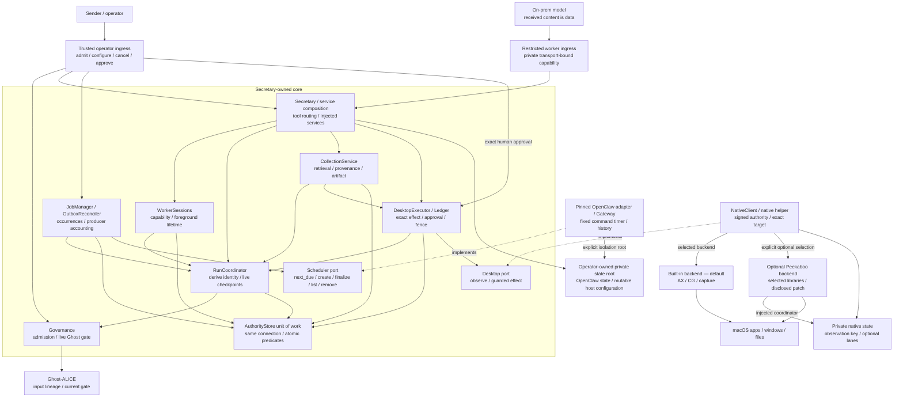
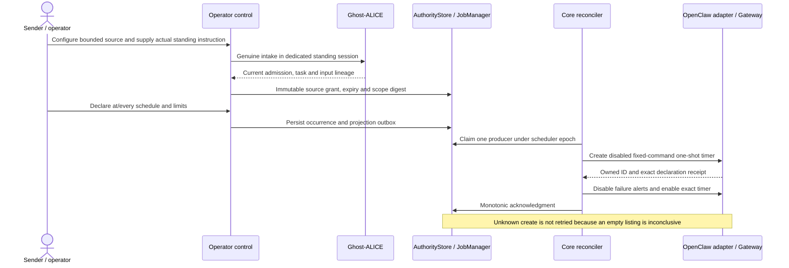
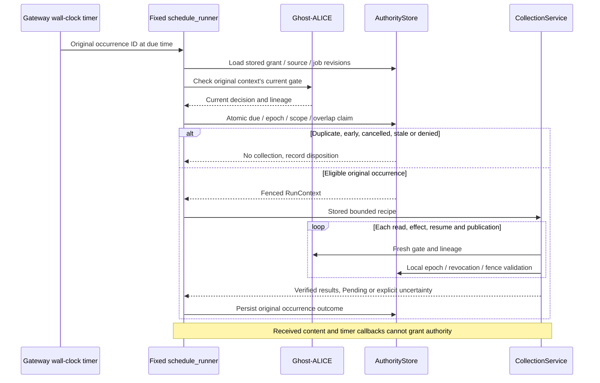
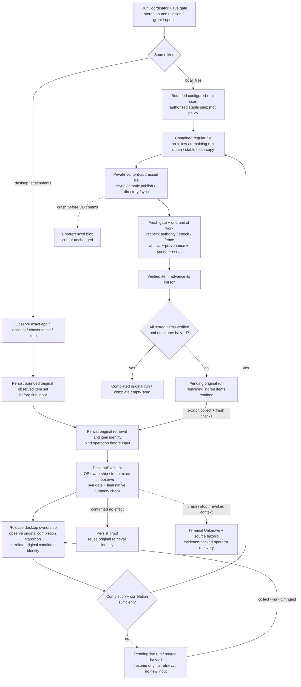
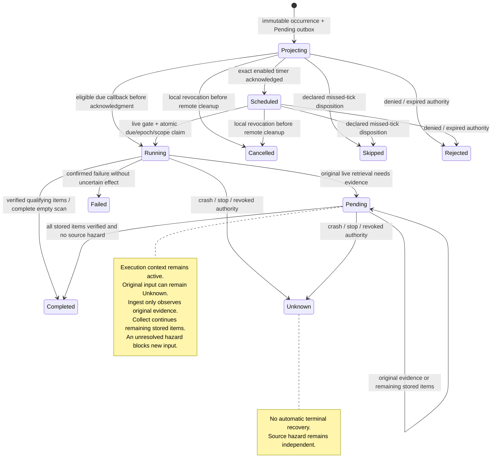

# Architecture

Operator guide: [English](./README.md) | [Korean](./README_ko.md). The paired guides keep installation, model configuration, first use, collection, scheduling, stopping, approval and recovery together.

AI Secretary is an independent Ghost-ALICE addon for broad local desktop work. Ghost-ALICE supplies the original user admission and live gate. The Secretary core owns authority, outgoing approval, collection evidence, jobs and desktop effects. OpenClaw supplies replaceable inference and timer adapters; selected Peekaboo libraries supply an optional macOS input backend. Neither adapter owns the user's authority.

## Contents

- [Component dependencies](#component-dependencies)
- [Human authority and scheduled continuation](#human-authority-and-scheduled-continuation)
- [Retrieval and artifact publication](#retrieval-and-artifact-publication)
- [State, restart and resource lifetime](#state-restart-and-resource-lifetime)
- [Contracts and engineering properties](#contracts-and-engineering-properties)
- [Source boundaries](#source-boundaries)
- [Native integration](#native-integration)
- [Model and process boundaries](#model-and-process-boundaries)
- [Installation and release boundaries](#installation-and-release-boundaries)
- [Verification scope](#verification-scope)

## Component dependencies

These diagrams retain the design reviewed before implementation and now describe the source implementation. Installation and real model/app readiness are separate stages.

Arrows point to dependencies, not execution order. The service composition routes tools and injects services; RunCoordinator derives/checks authority and does not depend on collection/executor implementations. Core modules depend on typed contracts and ports rather than upstream chunk names or SDK classes. The OpenClaw inference adapter is another host route into the restricted worker ingress. Direct operator invocation and MCP use the same core without that inference adapter. Generic foreground desktop work does not require a collection source or an app-specific API.

The model tool catalog has ten entries: status, apps, windows, observe, act, files, draft, collect, ingest and artifacts. OpenClaw and MCP hold worker capabilities outside tool arguments and bind them to the transport and current admitted session. Model arguments cannot create intake, select authority/session identity, approve a draft, grant a source, configure a timer or write the authority store. Operator control commands handle those operations. A literal `origin: external_user`, a PTY or an automated approval click is not authentication. This protocol boundary does not protect against an unrestricted malicious process running as the same OS user.

Repositories share one explicit `AuthorityStore` unit of work and connection for cross-module claims. No transaction spans a Ghost call, Gateway request, native input or file copy. The durable current-admission mirror joins the native final check; an old gate sample cannot keep an earlier context dispatchable after that mirror changes. External Ghost state and the local database do not form one globally atomic transaction.

## Human authority and scheduled continuation

`source grant --text` creates a separately admitted standing context. A grant without `--text` explicitly binds the currently admitted request instead. Scope contains the source root, recipe, app/account/conversation when applicable, limits and expiry. Scheduled collection confers no outgoing-message authority. A separate standing grant is executed by its fixed timer or operator collection; model collect/ingest instead requires a grant bound to the current worker's exact session/admission/task/input. A configured source alone does not transfer standing authority to another chat. A source revision preserves its physical identity; changing the physical root/app/account/conversation requires a different source identity. Changing the permitted recipe or scope requires a new revision and grant.

`control-sessions.sqlite` stores interactive routes and conversation UUIDs; `admissions.sqlite` stores the Ghost bridge's admission records. Authority, jobs, drafts, effects, retrievals and worker lifetimes share `operations.sqlite`. Existing task, conversation and approval identities remain intact. Ordinary user-run follow-ups preserve the conversation; `run --new-task` creates a separate task. A timer does not replay human intake.

Secretary allocates each occurrence before projecting it. The fixed command is the owned Python launcher plus `-m ai_secretary.schedule_runner --state … --occurrence …`; arbitrary model argv and delivery are excluded. Supported schedules are an absolute `at` timestamp or an `every` interval with an optional anchor, bounded runs/lateness and explicit skip/coalesce policy. Timestamps carry a timezone or an epoch value. Calendar cron expressions are not supported.

A due callback can claim an eligible `Projecting` occurrence before acknowledgment. Late acknowledgment adds metadata without resetting a running or terminal result. The core reconciler owns durable declaration repair and allocation of subsequent occurrences; the Gateway executes due timers. There is no second Python cron execution engine.

## Retrieval and artifact publication

A source item identity differs from its content hash: two messages can contain identical bytes and still need separate provenance. Local-folder collection reports a bounded stable snapshot, not that another producer finished a download. Desktop collection uses the immutable `desktop-attachment-v1` recipe: exact app/window/account/conversation/item selectors, a unique actionable download control, one filename and a before/after completion transition on the same visible node. The after text names the exact filename. Optional expected size/hash strengthen that evidence.

The original bounded observed item set is persisted before the first input. Byte/item limits apply across that original run, not separately to each collect/ingest/resume call: remaining quota is the declared limit minus verified original items, including reused artifacts. Ingestion rechecks the quota in its final publication unit of work; a resumed run cannot complete above its declared budget. A later collect/resume continues that set instead of reenumerating it and silently dropping vanished items. The final owner-held observation records the pre-input completion node and file baseline. Publication requires the same app/process/window, the observed completion transition and a changed or newly created candidate identity, followed by contained stable copying and hashing. An old same-name file, folder appearance, a paused partial file, an input receipt or a model-supplied “complete” flag is insufficient. CAS artifact identity, provenance, retrieval state, cursor and result commit together after publication and a fresh authority check. A crash before the database commit can leave an unreferenced blob; it cannot advance the cursor.

Verification of one item advances only that item's cursor. The original run becomes `Completed` only when every stored item is verified and no source hazard remains. Read-only ingest can return `Pending` when other original items remain; an explicit collect continues them under fresh checks. A private collection click stays operation `Unknown` until verified ingestion makes its exact operation and retrieval `Applied`/`Verified`. A normal live result with its own unresolved retrieval keeps the run `Pending`, its execution context active and its source reservation retained. `collect --run-id` and `ingest` observe/correlate that original retrieval without another click. Another occurrence, source revision or new operation ID cannot bypass the source hazard. A crash, stop or revocation produces terminal uncertainty; no automatic terminal-`Unknown` resolver is shipped.

General outgoing work follows a separate path: store the exact account, recipients, body, attachment hashes, composer identity and intent; obtain the sender user's approval of that digest; compare the current composer and intended commit against the grant; dispatch under fresh authority; verify the actual result. The recipient is not the approver. Broad desktop permission authorizes useful work within the user's task but does not authorize unsolicited replies or invitations. Outgoing button labels remain assistive heuristics rather than universal GUI semantics.

## State, restart and resource lifetime

Occurrence states, native operation states and timer outbox phases are separate. Generic operation `Applied` proves input dispatch, not a saved file or sent message. `Failed` requires proven no effect; uncertain accepted input becomes `Unknown`. The outbox has `Pending / Creating / Unknown / Acked / Removing / Removed` phases, while durable producer rows track `Creating / Unknown / Accounted`.

A cross-process `scheduler-projection.lock` serializes cooperating projectors. Producer ownership is persisted before remote creation. An unknown create cannot be retried merely because a listing is empty: a previously accepted remote request may commit later. Reconciliation checks complete owned inventory, repairs disabled exact timers without another add, and accounts for late producers. A missing acknowledged timer can be reprojected under the same unclaimed occurrence identity and current misfire policy. Removed tombstones remain in the reconciliation inventory; late owned timers are still removed. Unaccounted producers block successful drain and uninstall.

Lifecycle authority is `(lifecycle_id, epoch)`. Foreground worker lifetimes and operator collections have separate lifecycle IDs; the scheduler uses `scheduler`. Scheduler stop disables only its lifecycle. Global stop invalidates all addon-owned lifecycles. Both invalidate authority before waiting for quiescence. Desktop contention and source hazards remain global across those identities.

`desktop-dispatch.lock` is an OS lock retained through the native process tree's quiescence and confirmed reaping. The child inherits the same open file description; lease expiry alone cannot steal its desktop. The parent releases ownership only after native cleanup. No model inference or download wait holds this lock. Each new effect obtains a fresh fence and fresh signed observation under its current operation/attempt; earlier observations remain target data and cannot be relabeled into authority.

Stop accounts for potentially started input and projection producers before recording a drain. Restart uses a new epoch and reconciles stored declarations without resetting uncertainty. An unreachable Gateway, uncertain creation/removal, live native owner or incomplete inventory leaves `Draining` and preserved cleanup capability. Deleting an executable cannot prove those effects stopped.

## Contracts and engineering properties

| Contract or property | Concrete implementation rule |
| --- | --- |
| Responsibility and cohesion | Governance admits/checks; coordinator derives authority; executor performs effects; collector verifies artifacts; jobs project timers; installers own resources. |
| Dependency direction and abstraction | Core depends on immutable contracts and replaceable scheduler/desktop ports; adapters depend on upstream APIs. Ghost-ALICE remains a separate foundation. |
| Types, API contracts and invariants | Frozen `SourceSpec`, `JobGrant`, `ExecutionContext`, `RunContext`, `ScheduleSpec`, projection and receipt types carry exact lineage, revision, scope and lifecycle identities. Construction alone grants nothing. |
| State and effects | Caller-owned same-connection units of work arbitrate claims. Gate checks, native input, timer RPC and file publication happen outside SQL transactions. |
| Change locality and duplication | One packaged tool catalog/provider policy; adapter-specific APIs, native ABI, source pins and patches stay at their boundaries. |
| Object composition and hidden dependencies | Native backend selection is operator state. Peekaboo receives a private coordinator, in-memory snapshots and noop feedback explicitly; no shared host or default global coordinator. |
| Data structures and complexity | Source traversal, bytes/items, AX trees/selectors, transport payloads and recipe text are bounded. Stable declaration/source/item identities support indexed reconciliation and deduplication. |
| Time and resource lifetime | Due-time eligibility, expiry, lateness, epoch and fences are explicit. OS ownership survives the native child; cancellation is handled before authority can be reused. |
| OS contract and responsiveness | Exact process generation/window binding, fresh selectors, permission reporting, short reservations and bounded process cleanup precede effects. |
| Storage and compatibility | Additive durable schemas preserve existing tasks/drafts/operations. Mutable state remains separate from owned program files; partial removal preserves retry evidence. |
| Errors, debugging and verification | Refusal/no-effect differs from uncertain accepted input. Independent design, contract, fault/race, real-window, wall-clock timer and installation checks have separate evidence scopes. |

Design review caught the authority/session split, early callback race, uncertain late producer, cross-repository transaction gap, source-wide hazard, hidden Peekaboo state, lost observation ownership and stop/remove lifetime gap. The diagrams incorporate their corrected contracts; component tests and bounded integration checks exercise those boundaries. A passing check on one dimension does not certify another.

## Source boundaries

| Surface | Responsibility |
| --- | --- |
| `runtime.py`, `adapters/openclaw.py` | Immutable user-run request, persisted conversation route and replaceable inference-host dispatch. |
| `governance.py`, `authority.py`, `authority_contracts.py`, `coordinator.py` | Ghost bridge, explicit unit of work, immutable authority and live/local run validation. |
| `worker_sessions.py`, `rpc.py`, `openclaw-plugin/` | Host-private transport capabilities, restricted model tools and drained worker lifetime. |
| `service.py`, `execution.py`, `ledger.py`, `desktop_owner.py` | Tool composition, exact effect/draft binding, durable operations and native OS ownership. |
| `collection.py`, `desktop_collection.py` | Bounded local/desktop collection, original retrieval correlation and verified content-addressed artifacts. |
| `jobs.py`, `adapters/openclaw_scheduler.py`, `schedule_runner.py` | Durable declarations/producers, pinned timer translation and exact due callback. |
| `operator.py`, `control.py` | User control for sources, grants, schedules, backend selection, approval and stop. |
| `resources/` | One tool catalog, route policy and Ghost gate resource, read by Python and the plugin. |
| `native/` | Independent builtin helper, optional selected Peekaboo libraries, signed ABI, pins, patches and notices. |
| `scripts/installer.py` | Private runtime, selected native products, owned wrappers, staged publication and safe removal. |
| `native/TestWindow.swift`, `tests/`, smoke scripts | Bounded synthetic fixtures; the test application is excluded from installation. |

## Native integration

The optional backend selects Peekaboo `4.6.0` at `b54551ce2d0013e52c2a405bfeabced88ec5c2e0`, matching the selected OpenClaw `2026.9.8` source at `fc23bc864e4553c2d215e479eeec47b67a0bf943`. It links `PeekabooAutomationKit` and `PeekabooFoundation` with their required closure. The whole Peekaboo app, shared host, upstream authorization and fuzzy element resolution are excluded from the selected input path. The [native source manifest](./native/UPSTREAM.json), [patch](./native/upstream/secretary-owned-lanes.patch), [ABI](./native/ABI.md) and [notices](./native/THIRD_PARTY_NOTICES.md) record the boundary.

The disclosed patch changes three upstream files: two inject Secretary-owned coordination state, and one propagates the forbidden AX-value delivery flag to exact-window pointer event delivery. The helper carries signed bounded observations between requests and resolves the target freshly. It uses a private in-memory snapshot manager, noop feedback and coordination root. No optional backend error silently triggers another backend after a possibly started effect.

Both helpers support observation, guarded focus/open, click, Unicode typing and shortcuts subject to their reported capabilities. Drag and point scroll are builtin-only. The optional backend is selected explicitly at installation or through operator backend configuration. macOS permissions belong to the actual execution identity. The raw helper status field `actual_input_qualified` does not read external fixture evidence; use the scoped verification record rather than interpreting that field as a universal application certification.

Final native authorization verifies the HMAC envelope, inherited OS lock, exact current admission, active context/lifecycle, operation/attempt and lease/fence in one short read snapshot. Collection adds original grant, source revision and unresolved-retrieval predicates. SQLite opens the existing private authority database without CREATE and sets/verifies `query_only=ON` before the snapshot; filesystem write access is limited to SQLite's WAL coordination need, not permission to mutate authority rows/schema. SQL closes before OS input or async SDK calls.

## Model and process boundaries

The installed model policy currently accepts the declared Ollama route. Defaults are `http://127.0.0.1:11434` and `qwen3-vl:8b`; the installer supplies neither a model server nor weights. Vision/tool declarations cannot add capabilities to a model. Actual endpoint, model execution location and network isolation must be verified separately. Screens, messages and attachments stay on the operator's verified on-prem route; cloud fallbacks and content-forwarding channels are excluded.

Mutable `<prefix>/state/openclaw.json` stores model/runtime host configuration; `<prefix>/state/secretary/runtime.json` stores native backend/binary and owned scheduler executable/state paths. The scheduler adapter receives the explicit private isolation root `<prefix>/state`: its OpenClaw state directory and mutable host configuration are separate paths within that root. Source fixtures may use the OpenClaw state directory itself as the root. Composition supplies this boundary explicitly; neither an inferred parent fallback nor a model argument may expand it. Paths outside that root remain invalid. Reinstallation must preserve the existing host configuration path and bytes. Managed configuration files are initialization templates. Reinstall preserves existing mutable configuration. Doctor reads selected native permission/capability status; its localhost model hint is not an active configuration read or connection probe.

Stopping an OpenClaw client proves only its local cleanup. The foreground Gateway must be stopped in its own terminal when required. Secretary's lifecycle stop prevents subsequent cooperating tool effects but cannot claim that unrelated Gateway processes or opaque application effects stopped. Autopilot has its own approved run and continuation lifecycle; installing Secretary does not enroll or approve it.

## Installation and release boundaries

Installation stages owned code, runtime packages, selected native binaries, license files, launchers, skill and registry attribution before publication. The builtin helper is always independent; `--native-backend peekaboo` adds the optional product. `ai-secretary-python` is an owned Python launcher used by the fixed scheduled handler. The test window is never installed.

Before removal, the operator stops and drains addon-owned lifecycles/timers, exits owned clients and stops the owned Gateway. The installer holds runtime/desktop/projector locks and checks durable quiescence; it refuses deletion while a live owner, active context, projection obligation or uncertain producer remains. Refusal preserves cleanup capability. Once those guards pass, removal targets unchanged owned files/registrations and preserves mutable configuration, task/conversation state, user changes and unrelated resources. A recorded multi-platform install is one shared bundle; changing its registry selection requires removal with the original selection before reinstall.

The source release includes selected native sources, their transitive Swift lock and notices; runtime OpenClaw/Node packages are provisioned separately. Their exact top-level versions/integrity are checked. npm transitive resolution remains an installation-time dependency set rather than a reproducible whole-runtime lock. The official Core alias remains pending in [Ghost-ALICE PR #47](https://github.com/AidALL/ghost-alice/pull/47); the complete addon installer is the available route.

## Verification scope

Bounded source verification on 2026-10-09 exercised actual Peekaboo input in the owned test window (Unicode typing, click, file creation and window screenshot), then the generic attachment recipe through verified retrieval/artifact publication. A separate isolated Gateway wall-clock command timer ran the real local-file collection pipeline, verified its artifact and left zero owned remote timers after cleanup. These fixtures use disposable local data to test machinery; they are not a request to synthesize the user's business data.

A separate disposable-prefix installation validated its configuration and recognized the skill/plugin. At 04:13:13 UTC, the current installed Peekaboo binary passed real focus/click/Unicode typing/download/window-screenshot and tampered-observation refusal checks, with two tests and no skips. The installed generic recipe's verified 58-byte artifact evidence retains its original 04:04:11 UTC time; it was reused after the configuration-root repair rather than relabeled as a new collection. At 04:14:52 UTC, the installed owned Python launcher and Gateway completed a future wall-clock command timer, verified a 45-byte artifact, left zero owned remote timers and reached scheduler `Stopped`. An attempted removal while a client was active was refused. After stopping the owned Gateway and lifecycles, isolated removal passed at 04:16:48 UTC: owned managed files, skill and registry were removed, while 580 state files and foreign skill/registry resources were unchanged; volatile SQLite WAL/SHM files were excluded from that comparison. These checks used disposable local data without inference or outgoing messages.

These checks establish the tested source and isolated installed native/collection/timer paths. They do not establish live model inference, KakaoTalk/WeChat workflows, universal outgoing GUI semantics, automatic terminal-`Unknown` recovery or completed removal/refresh of the user's regular installation. Installation, contract/race tests, actual native input, wall-clock scheduling, model inference and each app's business result remain distinct verification dimensions.
