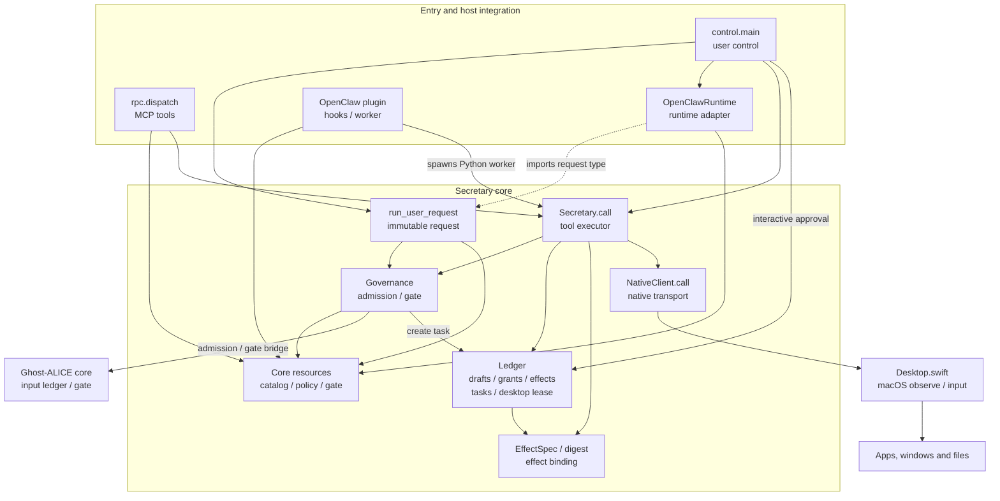
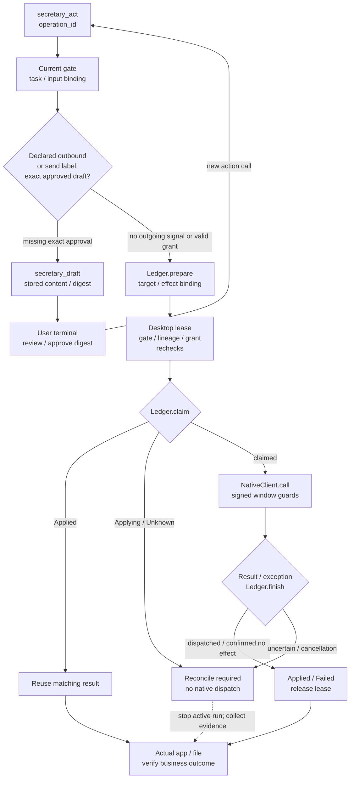

# Architecture

Operator guide: [English](./README.md) | [Korean](./README_ko.md). Both guides cover installation, model configuration, first use, stopping, approval and recovery on one page.

AI Secretary is an independent Ghost-ALICE addon for broad local desktop work. Its core owns actual user admission, conversation identity, outgoing draft approval and desktop effect records. The bundled OpenClaw adapter supplies an inference host; replacing that adapter does not move these responsibilities out of the core.

## Contents

- [Component dependencies](#component-dependencies)
- [Source boundaries](#source-boundaries)
- [Admission and continuity](#admission-and-continuity)
- [Approval and effects](#approval-and-effects)
- [Action, approval and uncertain effects](#action-approval-and-uncertain-effects)
- [Model and process boundaries](#model-and-process-boundaries)
- [Installation and release boundaries](#installation-and-release-boundaries)

## Component dependencies

Arrows point from a component to a dependency it uses; they are not a chronological execution sequence. The dotted adapter edge is a request-type import. At runtime, `run_user_request` calls the selected adapter's `dispatch` after admission and gate validation. The OpenClaw path then uses the agent client/Gateway, model and plugin worker; the direct `invoke` and MCP paths call `service.handle` without that inference adapter. Each reaches `Secretary.call`, which consults the ledger and independently invokes `NativeClient.call`. The ledger never executes native actions. `secretary_files` lists a directory in Python rather than invoking the native driver.

Conversation identity is stored in `control-sessions.sqlite`, admissions in `admissions.sqlite`, and tasks, exact drafts, grants, operations and leases in `operations.sqlite`. The native driver also uses a private observation-signing key. These are durable authorities, not model-process memory. The paired [README overviews](./README.md#system-at-a-glance) show the call routes and optional Autopilot boundary.

## Source boundaries

| Surface | Responsibility |
| --- | --- |
| `src/ai_secretary/runtime.py` | Frozen `RunRequest`, replaceable `Runtime` protocol, persisted conversation identity, original user admission and gate before dispatch. |
| `src/ai_secretary/governance.py` | Bridge to the installed Ghost-ALICE input ledger and current downstream gate. |
| `src/ai_secretary/service.py`, `ledger.py`, `contracts.py` | Task-bound tools, exact draft approval, operation identity, retries, desktop lease and effect uncertainty. |
| `src/ai_secretary/resources/` | One canonical tool catalog, provider route policy and Ghost-ALICE gate script. Python reads these as package resources. |
| `src/ai_secretary/adapters/openclaw.py` | OpenClaw executable resolution, argv and local client cleanup. |
| `openclaw-plugin/` | OpenClaw hooks, native session binding, tool registration and image result formatting. |
| `native/Desktop.swift` | macOS window observation, accessibility, screenshots and guarded mouse/keyboard/file actions. |
| `scripts/installer.py` | Complete private Node/OpenClaw bundle, native build, launchers and ownership-aware install/reinstall/uninstall. |
| `native/TestWindow.swift`, `tests/`, smoke scripts | Synthetic and opt-in integration fixtures. The test-window executable is excluded from the installed product. |

The Python package's MCP catalog and governance gate work without the `openclaw-plugin` directory. The current distribution ships one inference adapter, OpenClaw. It does not ship a second inference engine.

OpenClaw may capture the plugin package into a temporary loading directory. At registration the plugin reads canonical schemas and policy through its configured `source`, which also supplies the Python worker's import path. Ordinary direct imports can resolve the physical sibling `src` directory. No second schema or policy copy is maintained inside the plugin.

## Admission and continuity

The production user-run function accepts the exact text supplied by the user, records a real admission, checks the current Ghost-ALICE gate and then sends an immutable request to the selected runtime. Provider route rejection happens before runtime dispatch.

`control-sessions.sqlite` persists the route and conversation UUID. The binding is `route::UUID`; ordinary follow-ups preserve the conversation and TaskId. `run --new-task` creates a distinct conversation and task. OpenClaw native session keys and session IDs are bound together so a new native session cannot reuse a previous conversation's admission. Admission identities cannot be replayed with changed text or replace a newer admission.

The existing Ghost-ALICE ledger namespace `openclaw` is explicit compatibility storage. It does not make the Secretary core dependent on OpenClaw as an inference host. Existing admitted conversations and grants retain their identity.

Current-user text, admission identity and external-user provenance must come from the user-operated runner or actual host facts. A projected model prompt, tool arguments, received document or old conversation is not a substitute for new user input. The pinned CLI's native admission fields are incomplete on the demonstrated path, so the user-operated `ai-secretary run` entrypoint is required there.

## Approval and effects

Preparing an outgoing draft does not approve it. The worker stores the account, recipients, body, attachment content hashes and invitation details. The user reviews that stored content through an interactive terminal and approves its exact digest. Changes to the draft invalidate the grant. Grants are task-bound; continuation preserves them, while a separate task cannot use the old draft's approval.

Each `operation_id` binds the current task to the action, target and business effect. Refreshed observation tokens do not change the effect identity. Reusing an operation for a different effect is rejected; a completed matching effect reuses its result. A desktop lease prevents simultaneous cooperating workers from claiming the desktop. The worker checks the current gate, task, input lineage and approval again before invoking an effect.

Native actions require a fresh observed window and matching process/window guards. Uncertain claimed effects require reconciliation before another attempt: a worker that can persist the result records `Unknown`, while a hard interruption can leave `Applying`. Recorded OS input completion does not establish that an app saved a file or sent a message.

The outgoing button label check is an assistive heuristic. It does not recognize every app's opaque GUI meaning or automatically prove that a composer matches the approved draft. The user's approval rule and visual interpretation remain required.

## Action, approval and uncertain effects

This flow spans separate tool calls and the user's approval command. A missing grant rejects an action identified as outgoing; it does not cause the worker to approve or send. The worker validates declared `outbound` content and rejects known send labels without it. Recognizing other outgoing UI semantics still requires the skill's visual interpretation. Blocked admission, changed lineage, conflicting operation identity, invalid approval or unavailable lease stops execution before the effect. Native observation guards identify a recent process/window and input target; they do not certify the app's business meaning or composer/draft equivalence. The sender and operator must review those against the actual screen.

`Applied` records successful native dispatch, not a verified save or send. `Failed` requires evidence that the effect did not start. An uncertain result after a claimed attempt is recorded as `Unknown` when the worker can finish its record. The plugin's hard timeout or abort can kill the worker before that write, leaving `Applying`; `Ledger.claim` requires reconciliation for both states. The arrow to observation is an operator recovery step, not an automatic state transition. Automatic reconciliation is not implemented; `recover_inflight` is a storage primitive with an exclusive-worker-lock precondition, not a wired recovery service.

Source anchors: [`run_user_request`](./src/ai_secretary/runtime.py), [`Secretary.call`](./src/ai_secretary/service.py), [`Ledger.prepare`, `claim`, `finish`, `approve` and `validate_approval`](./src/ai_secretary/ledger.py), [`worker`](./openclaw-plugin/index.mjs), [`NativeClient.call`](./src/ai_secretary/native.py), and [`guardObservation` / `execute`](./native/Desktop.swift).

## Model and process boundaries

`src/ai_secretary/resources/model-policy.json` currently accepts the declared Ollama provider route. The initial template defaults to `http://127.0.0.1:11434` and `qwen3-vl:8b`, and permits Secretary tools. The addon installs neither the model server nor model weights. GUI execution requires actual vision and tool-calling capability in the selected model; an authored `input: ["text", "image"]` declaration cannot supply missing capability.

Installed launchers select the mutable `<prefix>/state/openclaw.json`, defaulting to `~/.local/share/ai-secretary/state/openclaw.json`, and use `<prefix>/state/openclaw/` for OpenClaw state. The managed `config/openclaw.json` is an initialization template. Reinstall preserves an existing state configuration. Endpoint/model changes must keep `models.providers.ollama.baseUrl`, `models.providers.ollama.models[0].id` and `agents.defaults.model.primary` consistent; the primary is `ollama/<model-id>`. The paired operator guides use the pinned CLI's JSON batch to update these together.

A provider name does not attest that the actual model server is on premises. Raw MCP transport also cannot verify an upstream host's model or network location; actual endpoint configuration, model execution location and network isolation require separate checks. Personal messages, attachments and screens must not be forwarded through external models, fallbacks, channels or telemetry paths.

Installer `status` establishes ownership, drift and registration, while reporting model and accessibility as `not-checked`; its lock can also recover an interrupted install. `ai-secretary doctor` queries native Accessibility and Screen Recording flags. Its `model_endpoint` text is a hardcoded localhost hint, not an active-config read or connection probe. Schema validation, native permissions, endpoint/model availability, real inference and the actual selected app/file result are distinct evidence. Installation, Gateway startup, protocol stubs and test-window success do not close the latter stages.

Interrupting the local OpenClaw client terminates and reaps that client, including repeated Ctrl-C cleanup and cancellation from a worker-thread event loop. This does not prove the Gateway run stopped. For the foreground `openclaw gateway run --bind loopback` used in the guide, Ctrl-C in the Gateway's own terminal stops that process. Wait for it to exit, then inspect the actual app/file or outgoing effect before retrying. Automatic `Unknown` reconciliation is not implemented; preserve uncertain records until an evidence-backed resolution is available.

Ghost-ALICE's current input gate governs Secretary admission and tools. Autopilot's approved run and continuation hooks are a separate lifecycle; Secretary installation does not enroll or approve an Autopilot run.

## Installation and release boundaries

The complete addon installer stages and verifies the private runtime, application sources, native executable, skills and registry attribution before publication. It tracks immutable managed files separately from mutable Secretary/OpenClaw state. Collision, drift and interrupted-install recovery are handled before replacing owned resources. Removal preserves user modifications and state; its retry command remains available through partial removal.

Typed `platform_registries` map platform identities to ordinary Ghost-ALICE registry directories. Each selected platform sidecar participates in the same addon-owned transaction as the shared runtime and skills. The standalone single-directory mode remains compatible with existing installs. Switching a recorded registry selection requires explicit removal with the original selection before reinstall; it does not silently adopt another record. Removing a shared official installation removes all of its selected platform resources. Core dispatch uses its fixed managed handler rather than executing arbitrary registry command text.

The source release includes the adapter and installer, while the installer provisions the pinned OpenClaw and Node packages in a private prefix. It does not vendor a local runtime cache into this repository. Exact top-level versions and package integrity are checked, but network installation currently resolves transitive npm dependencies at install time. It is not a reproducible dependency lock for the entire runtime.

The first desktop backend requires macOS 14 or later and a Swift compiler. The portable Python core does not imply that the desktop addon is supported on other operating systems. Real model inference, actual KakaoTalk/WeChat attachment workflows, universal outgoing GUI semantics and automatic `Unknown` reconciliation remain separate validation work.
