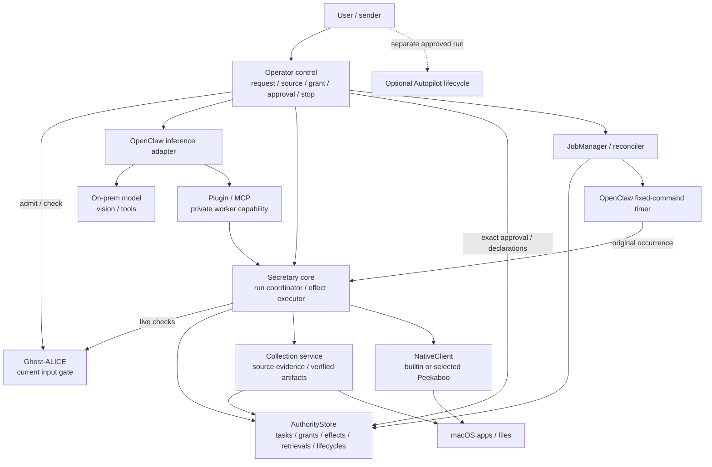

# AI Secretary

Language: English | [Korean](./README_ko.md)

AI Secretary is an independent [Ghost-ALICE](https://github.com/AidALL/ghost-alice) addon for local desktop work across apps, including KakaoTalk and WeChat. The Secretary core owns user authority, exact outgoing approval, conversation identity, verified collection, timer declarations and desktop effects. Replaceable OpenClaw adapters host inference and fixed-command timers; native macOS tools use the independent builtin or explicitly selected Peekaboo backend. App-specific APIs are optional.

Current addon source version: `0.1.0`. Public source: [AidALL/ghost-alice-ai-secretary](https://github.com/AidALL/ghost-alice-ai-secretary). This page is the complete operator guide. See [Architecture](./ARCHITECTURE.md) for implementation boundaries, [Apache-2.0](./LICENSE) for the source license and [third-party notices](./THIRD_PARTY_NOTICES.md) for the provisioned runtime.

## Contents

- [System at a glance](#system-at-a-glance)
- [Requirements](#requirements)
- [Install the complete addon](#install-the-complete-addon)
- [What to review before first use](#what-to-review-before-first-use)
- [Check first-use readiness](#check-first-use-readiness)
- [Configure the on-prem model](#configure-the-on-prem-model)
- [Check the endpoint and real inference](#check-the-endpoint-and-real-inference)
- [Check macOS permissions](#check-macos-permissions)
- [Start a real task](#start-a-real-task)
- [Collect verified files](#collect-verified-files)
- [Schedule a bounded collection](#schedule-a-bounded-collection)
- [Stop and retry](#stop-and-retry)
- [Approve outgoing work](#approve-outgoing-work)
- [Custom paths, reinstall and removal](#custom-paths-reinstall-and-removal)
- [Privacy and current limits](#privacy-and-current-limits)
- [Development validation](#development-validation)

## System at a glance



Arrows show the principal control/tool routes. The core derives authority and records effects; native input and file verification remain separate responsibilities. OpenClaw supplies both the shipped inference route and selected fixed-command timers. Direct operator invocation and MCP use the same core; an upstream MCP model/network requires its own review. Scheduler declarations and sender approval remain operator operations. Autopilot is optional and separately approved.

The [architecture diagrams](./ARCHITECTURE.md#component-dependencies) now describe the implemented authority, collection, timer and restart contracts reviewed before coding. OpenClaw's fixed-command timers are reused directly; the optional native backend links selected Peekaboo libraries with disclosed private-state/input patches. The built-in macOS driver remains independent and is the default. Installation and real model/app readiness remain separate checks.

## Requirements

- macOS 14 or later, Python 3.11 or later and a Swift compiler.
- An installed Ghost-ALICE core and its actual source checkout path.
- A reachable on-prem Ollama server with the selected model already installed. Model weights and the model server are separate from this addon.
- A model that actually supports vision and tool calling for GUI work, plus macOS Accessibility and Screen Recording permission for the execution environment.

Ghost-ALICE supplies the input ledger and current gate. [Autopilot](https://github.com/AidALL/ghost-alice-autopilot) has its own approved-run state and continuation hooks; installing Secretary does not approve or activate an Autopilot run. The English/Korean pairing follows the Core and Autopilot documentation convention, while the operator instructions remain together on this page.

## Install the complete addon

Set `SECRETARY_GHOST_ROOT` to your actual Ghost-ALICE source checkout, then install from this addon checkout:

```sh
export SECRETARY_GHOST_ROOT="$HOME/ghost-alice"
git clone https://github.com/AidALL/ghost-alice-ai-secretary.git "$HOME/ghost-alice-ai-secretary"
cd "$HOME/ghost-alice-ai-secretary"
./scripts/install.sh --ghost-alice-root "$SECRETARY_GHOST_ROOT" --native-backend peekaboo
python3 scripts/installer.py status
```

This command explicitly selects Peekaboo and also retains the independent builtin helper. Omit `--native-backend peekaboo` to choose builtin for a new install. Repeat the selected backend option when reinstalling. The installer provisions the skill, Secretary program, selected native helpers, their notices, owned worker/Python launchers, OpenClaw `2026.9.8` and Node `24.21.0` together. Defaults are `~/.local/share/ai-secretary` for the program, `~/.agents/skills/ai-secretary` for the skill and `~/.ghost-alice/addons/ai-secretary.json` for the registry record. It does not start a background service, install model weights or prove inference readiness. If already installed, continue with the readiness checks using the original installation paths.

The official Core `ai-secretary` alias is being prepared in [Core integration PR #47](https://github.com/AidALL/ghost-alice/pull/47), pending merge and delivery. Use this addon's installer until that integration is available in your installed Core. The existing generic Core `--addon-source` path installs skill content and does not provision this complete runtime.

The installer checks the top-level OpenClaw version and npm integrity, and the Node version and distribution archive checksum. Network installation still resolves npm transitive dependencies at install time; this is not a reproducible lock of the entire dependency set. `--openclaw-source` and `--node-source` reuse verifiable pinned caches for development validation.

## What to review before first use

| Review area | What to decide or verify |
| --- | --- |
| Operator decision: model and network | Read back the active on-prem URL and exact model ID. Verify actual vision, tool calling and network isolation, including upstream MCP hosts, fallbacks, channels and telemetry. A provider label or configuration declaration is insufficient. |
| Operator decision: first task | Name the app/window, selected attachment or file, absolute destination and observable success condition. Inspect the actual saved file or app result; installation, permissions and protocol checks establish different stages. |
| Sender decision: exact outgoing approval | Review the stored account, recipients, body, attachment hashes, composer identity, intent and invitation details before approving the exact digest. General desktop permission does not authorize sending. |
| Implementation gap: app meaning | Compare the actual composer with the approved draft and observe the final effect. The outgoing-label heuristic cannot prove every opaque app's meaning or composer/draft equivalence. |
| Implementation gap: recovery | Identify the Gateway stop control; stopping the local client does not prove Gateway work stopped. Inspect the effect before retrying. Live original retrievals can resume observation/ingestion; terminal `Unknown` recovery remains manual. Stop/drain and owned Gateway exit precede removal. |
| Distribution gap: Core alias | The official alias is pending in [PR #47](https://github.com/AidALL/ghost-alice/pull/47). Use this addon's complete installer until that integration is delivered in your Core. Secretary installation does not approve optional Autopilot work. |
| Per-app validation | Keep evidence specific to the tested app and workflow. One bounded success does not establish KakaoTalk, WeChat or another app's attachment, composer or send behavior. |

## Check first-use readiness

For the default install, use its launchers in every terminal used below. Substitute your original prefix if customized:

```sh
export SECRETARY_PREFIX="$HOME/.local/share/ai-secretary"
export PATH="$SECRETARY_PREFIX/managed/bin:$PATH"
openclaw config file
```

The launchers select `<prefix>/state/openclaw.json` and `<prefix>/state/openclaw/`. The default active configuration is `~/.local/share/ai-secretary/state/openclaw.json`. Edit this mutable state configuration, rather than the managed template at `<prefix>/managed/config/openclaw.json`. Reinstall preserves an existing state configuration, so reinstalling does not reset your endpoint or model selection. Native backend/binary and scheduler launcher paths are separately stored in `<prefix>/state/secretary/runtime.json`; the managed `config/runtime.json` is also an initialization template.

| Check | What it establishes | What remains to check |
| --- | --- | --- |
| `python3 scripts/installer.py status` | Owned installed files, drift and registration state | Model and permissions are explicitly `not-checked`; status may recover an interrupted installation under its lock. |
| `openclaw config validate` | Configuration schema validity | Endpoint reachability, model capability and inference. |
| `ai-secretary doctor` | Native Accessibility and Screen Recording permission flags | The configured model and real app behavior. Its `model_endpoint` is a hardcoded localhost hint, not a probe or active-config read. |
| Ollama catalog and model details | Endpoint response, available model ID and declared capabilities | A real inference response and actual GUI behavior. |
| A small real inference request | The selected server/model answers that request | Vision, tool use and the selected app/file outcome. |
| A bounded Secretary task in your selected app | The observed outcome for that app, file and request | Other apps or workflows remain separate checks. |

An `installed` status or `true` permission flags can coexist with a refused model connection. Report the highest stage actually checked; installation, Gateway startup and protocol smoke checks do not establish a functioning model or successful file workflow.

## Configure the on-prem model

The initial template declares `http://127.0.0.1:11434` and `qwen3-vl:8b`. These are defaults, not evidence that a server or model exists. Supply your actual on-prem native Ollama URL and exact installed model ID. Use the server's native API base URL without `/v1` or a trailing slash; the provider remains `ollama`.

Three settings must agree:

| Field | Value |
| --- | --- |
| `models.providers.ollama.baseUrl` | Actual on-prem Ollama base URL |
| `models.providers.ollama.models[0].id` | Exact model ID served there |
| `agents.defaults.model.primary` | `ollama/` followed by that same model ID |

Stop the foreground Gateway before changing these values if it is running. Replace both placeholders before executing this recipe. Python encodes the values as JSON, and the batch changes the three coupled fields together:

```sh
export SECRETARY_OLLAMA_URL='http://YOUR_ON_PREM_HOST:11434'
export SECRETARY_MODEL_ID='YOUR_INSTALLED_VISION_TOOLS_MODEL'
SECRETARY_MODEL_CONFIG_JSON="$(python3 - "$SECRETARY_OLLAMA_URL" "$SECRETARY_MODEL_ID" <<'PY'
import json, sys
endpoint, model = sys.argv[1:]
print(json.dumps([
    {"path": "models.providers.ollama.baseUrl", "value": endpoint},
    {"path": "models.providers.ollama.models[0].id", "value": model},
    {"path": "agents.defaults.model.primary", "value": "ollama/" + model},
]))
PY
)"
openclaw config set --batch-json "$SECRETARY_MODEL_CONFIG_JSON" --strict-json --dry-run
```

If the dry run passes and the values are correct, apply the same batch and read back the active settings:

```sh
openclaw config set --batch-json "$SECRETARY_MODEL_CONFIG_JSON" --strict-json
openclaw config get models.providers.ollama.baseUrl
openclaw config get 'models.providers.ollama.models[0].id'
openclaw config get agents.defaults.model.primary
openclaw config validate
```

Bracket paths are quoted for zsh. These commands use the pinned runtime's JSON batch mode and validate the final configuration; successful validation does not call the model. Its shipped command reference is `<prefix>/managed/openclaw/node_modules/openclaw/docs/cli/config.md`; the launcher/state wiring is in [the installer](./scripts/installer.py). Check the remaining model declaration too: `input: ["text", "image"]`, context window and output token limits must reflect the actual selected model. Writing `image` in configuration cannot add vision capability to a text-only model. If you already maintain a different model list, select the intended catalog entry consistently rather than changing an unrelated entry.

## Check the endpoint and real inference

Use the same actual endpoint and model variables configured above. The [catalog API](https://docs.ollama.com/api/tags) and [model-details API](https://docs.ollama.com/api-reference/show-model-details) provide the availability and capability checks:

```sh
curl --fail --silent --show-error "$SECRETARY_OLLAMA_URL/api/tags"
SECRETARY_SHOW_JSON="$(python3 - "$SECRETARY_MODEL_ID" <<'PY'
import json, sys
print(json.dumps({"model": sys.argv[1]}))
PY
)"
curl --fail --silent --show-error "$SECRETARY_OLLAMA_URL/api/show" \
  -H 'Content-Type: application/json' --data "$SECRETARY_SHOW_JSON"
```

Confirm the exact model appears in the catalog and inspect its declared `vision` and `tools` capabilities. GUI use requires both to work on your server/model; a catalog entry or capability declaration alone is insufficient. If the connection is refused, prepare or start the intended on-prem server before continuing. If the model is absent or unsuitable, have the server operator install/select a suitable model and repeat the configuration checks. [Ollama installation](https://ollama.com/download/mac) and the [model catalog](https://ollama.com/library) are separate server preparation references.

Request a real text response with the [chat API](https://docs.ollama.com/api/chat). This diagnostic sends a small prompt, without app content:

```sh
SECRETARY_PROBE_JSON="$(python3 - "$SECRETARY_MODEL_ID" <<'PY'
import json, sys
print(json.dumps({"model": sys.argv[1], "stream": False,
    "messages": [{"role": "user", "content": "Reply with READY only."}]}))
PY
)"
curl --fail --silent --show-error "$SECRETARY_OLLAMA_URL/api/chat" \
  -H 'Content-Type: application/json' --data "$SECRETARY_PROBE_JSON"
```

Inspect the returned model response and any error. A successful HTTP response with real generated content establishes this text inference check only. Verify actual screenshot understanding and Secretary tool use in the bounded app task below before claiming GUI readiness.

## Check macOS permissions

```sh
ai-secretary doctor
```

Doctor reports the selected backend and its actual capabilities as well as `accessibility` and `screen_recording`. Peekaboo supplies click/type/hotkey plus Secretary's guarded focus/open; drag and point scroll remain builtin-only. Select a packaged backend explicitly with `ai-secretary backend peekaboo --binary "$SECRETARY_PREFIX/managed/app/build/desktop-secretary-peekaboo"` or `ai-secretary backend builtin --binary "$SECRETARY_PREFIX/managed/app/build/desktop-secretary"`. Selection writes mutable runtime state and never silently retries a potentially started effect through another backend. Check `accessibility` and `screen_recording`. If either is false, grant the execution environment access in macOS System Settings → Privacy & Security → Accessibility / Screen Recording, then rerun from that same environment. The `model_endpoint` localhost text is fixed in the current doctor implementation even when the active configuration uses another on-prem server. Doctor does not test a model connection, load a model or run inference.

## Start a real task

After configuration, endpoint, inference and permission checks, keep the foreground Gateway running in one terminal:

```sh
openclaw gateway run --bind loopback
```

In a second terminal, set the same prefix and PATH, then supply your actual request to the user-operated runner. Replace the example's app, attachment and destination with your selected real task:

```sh
export SECRETARY_PREFIX="$HOME/.local/share/ai-secretary"
export PATH="$SECRETARY_PREFIX/managed/bin:$PATH"
ai-secretary run --runtime openclaw \
  'In WeChat, download the attachment I selected, save it to the folder I named, and open that folder.'
```

Choose a bounded first task with an identifiable app/window, actual attachment or file, absolute destination and observable completion condition. For example, inspect the saved file at that path and verify its contents before counting an attachment download as complete. A task with no selected app/file or destination cannot establish a real workflow result. KakaoTalk, WeChat and other apps use the same observation/action tools, but each app's GUI behavior needs its own observed outcome.

`run` records the original text you supply in Ghost-ALICE, checks the current gate and passes an explicit conversation route and UUID to the runtime. Ordinary follow-ups preserve the conversation and TaskId; `run --new-task` starts a distinct task. Existing conversation UUIDs and approval records are preserved. OpenClaw is the currently shipped inference adapter. Development can select an executable with `--runtime-executable /absolute/path/to/openclaw`; `--openclaw` remains a compatibility alias.

The demonstrated pinned CLI path does not supply all native current-request, admission-ID and provenance fields, so use `ai-secretary run` for user tasks. A host providing those real fields can use native admission. Assembled prompts, old conversation, tool arguments and received documents do not admit new user work.

For direct tools or MCP, first register the actual user task in the same conversation:

```sh
ai-secretary --session agent:main:secretary task 'Inspect the files in the downloads folder I named.'
ai-secretary --session agent:main:secretary invoke secretary_files \
  --args-json '{"path":"/absolute/path/to/downloads"}'
```

When continuing a conversation with a native session ID, pass `sessionKey::sessionId` to `--session`. OpenClaw `/new` and `/reset` separate earlier work through native session identity. Reusing an old session without the user runner does not guarantee current-request binding.

## Collect verified files

General foreground computer use needs only an admitted task. Configure a source when you want bounded, repeatable collection with durable provenance and cursor state. Direct collection and fixed scheduled recipes do not call a model.

For a local-folder source, choose an existing folder containing the files you want collected. This example creates an inbox and a scope file; place your own files in the inbox. The limits apply to the whole original run across collect/ingest/resume calls; verified items, including reused artifacts, consume the remaining quota. `filename_glob` selects relative paths.

```sh
export SECRETARY_INBOX="$HOME/Downloads/Secretary-Inbox"
mkdir -p "$SECRETARY_INBOX"
python3 - <<'PY'
import json, os
from pathlib import Path
Path("secretary-local-source.json").write_text(json.dumps({
    "root": os.environ["SECRETARY_INBOX"], "recipe": "local-snapshot",
    "filename_glob": "*", "max_items": 20, "max_bytes": 16777216
}))
PY
ai-secretary source configure inbox --kind local_files \
  --scope-file secretary-local-source.json
export SECRETARY_EXPIRY="$(python3 -c 'from datetime import datetime,timedelta,timezone; print((datetime.now(timezone.utc)+timedelta(days=1)).isoformat())')"
SECRETARY_GRANT_JSON="$(ai-secretary source grant inbox \
  --expires-at "$SECRETARY_EXPIRY" \
  --text "Collect the files in $SECRETARY_INBOX every 15 minutes for the next day; read and retain them locally.")"
SECRETARY_GRANT_ID="$(python3 -c 'import json,sys; print(json.loads(sys.argv[1])["grant_id"])' "$SECRETARY_GRANT_JSON")"
ai-secretary collect "$SECRETARY_GRANT_ID"
ai-secretary artifacts --source-id inbox
```

The grant's actual `--text` creates a separate `standing:<source>:<UUID>` admission. Later ordinary conversation updates do not replace it. Omitting `--text` is a different operation: it binds the currently admitted request in the selected `--session`; use that for a source the current model task may collect. The model cannot create either grant or enlarge its scope. Model collect/ingest requires the current worker's exact session/admission/task/input-bound grant; it cannot borrow a separate standing context merely because the source is configured. A dedicated standing grant is executed by its fixed timer or operator `collect GRANT_ID`. Source revisions preserve the physical root/app/account/conversation identity; use a different source ID for a different physical source. Revoke authority with `ai-secretary source revoke inbox`.

Verified artifacts contain content hashes, size, source/item identity and provenance, with blobs under `<prefix>/state/secretary/artifacts`. Local-folder collection establishes an authorized stable snapshot; it does not attest that another app finished producing a file.

### Desktop attachment recipe

`desktop-attachment-v1` uses one generic recipe across apps. Configure exact selectors from an observed app, including account, conversation, item, download control and a completion transition. Broad interactive mouse/keyboard work remains available when an app does not expose enough evidence for unattended verified collection.

This complete fixture-shaped scope illustrates the fields; replace the root and observed identities/selectors for the actual app. The owned development fixture has these exact labels. It is excluded from installation and creates disposable test data only.

```json
{
  "root": "/absolute/path/to/downloads",
  "recipe": "desktop-attachment-v1",
  "app": "local.ai-secretary.fixture",
  "account": "fixture-account",
  "conversation": "fixture-conversation",
  "max_items": 1,
  "max_bytes": 1048576,
  "desktop": {
    "app_selector": {"field": "bundle_id", "equals": "local.ai-secretary.fixture"},
    "window_title": "AI Secretary Self-Owned Test Fixture",
    "account_selector": {"role": "AXStaticText", "identifier": "fixture-account", "text": "fixture-account"},
    "conversation_selector": {"role": "AXStaticText", "identifier": "fixture-conversation", "text": "fixture-conversation"},
    "items": [{
      "item_id": "attachment-1",
      "item_selector": {"role": "AXStaticText", "identifier": "fixture-item", "text": "Attachment: fixture-download.txt"},
      "download_selector": {"role": "AXButton", "identifier": "fixture-download", "text": "Download Synthetic File"},
      "filename": "fixture-download.txt",
      "completion": {
        "before": {"role": "AXStaticText", "identifier": "fixture-status", "text": "No download yet"},
        "after": {"role": "AXStaticText", "identifier": "fixture-status", "text": "Downloaded: fixture-download.txt"}
      }
    }]
  }
}
```

Save the adapted scope as `secretary-desktop-source.json`, then use `ai-secretary source configure selected-attachments --kind desktop_attachments --scope-file secretary-desktop-source.json`, grant its actual instruction and collect the returned grant ID. The before/after selectors must identify the same visible node and the after text must name the exact filename. Optional item fields `expected_size` and `expected_sha256` strengthen completion evidence. A same-name old file or file appearance alone cannot pass.

A delayed download keeps its original retrieval and operation. While its original authority remains live, inspect `ai-secretary source list` for `active_run_id` and `unresolved_retrieval_id`, then use `ai-secretary collect GRANT_ID --run-id ORIGINAL_RUN_ID` or `ai-secretary ingest ORIGINAL_RUN_ID ORIGINAL_RETRIEVAL_ID /absolute/original/file`. These paths reobserve and ingest the original candidate without another download input. A verified item advances only its own cursor; the run stays `Pending` while any original stored item remains or a source hazard is unresolved. Explicit collect then continues the original item set under fresh checks. A stopped/revoked/crashed terminal `Unknown` cannot use this live resume path.

The model equivalents are `secretary_collect({"source_id":"…"})`, `secretary_ingest({"source_id":"…","retrieval_id":"…","path":"…"})` and `secretary_artifacts({"source_id":"…"})`. Their host derives run identity privately; model arguments cannot supply grants, sessions, completion flags or authority records.

## Schedule a bounded collection

Keep the owned foreground Gateway running as described above and retain the collection terminal. In another terminal using the same prefix/PATH, explicitly start the Secretary reconciler:

```sh
ai-secretary schedule start
```

Return to the original collection terminal, where `SECRETARY_GRANT_ID` remains set, to declare the bounded schedule:

```sh
SECRETARY_JOB_JSON="$(ai-secretary schedule create "$SECRETARY_GRANT_ID" \
  --every 900 --max-runs 96 --max-lateness 60 --misfire skip)"
SECRETARY_JOB_ID="$(python3 -c 'import json,sys; print(json.loads(sys.argv[1])["job_id"])' "$SECRETARY_JOB_JSON")"
ai-secretary schedule list
ai-secretary schedule reconcile
```

For a one-time schedule, use `--at` with an ISO timestamp containing a timezone instead of `--every`. An interval may use `--start-at` for its anchor. The declaration remains bounded by grant expiry. Supported misfire choices are `skip` and `coalesce`; calendar cron expressions are not supported.

The reconciler projects one fixed-command occurrence at a time and repairs durable declarations; OpenClaw executes it at wall-clock due time. It does not run an LLM, send a message or deliver a failure alert. Installation does not start either process or authorize a schedule. Use `ai-secretary schedule cancel "$SECRETARY_JOB_ID"` to revoke one job; `ai-secretary schedule stop` stops the scheduler lifecycle and owned projections while preserving unrelated foreground work.

An uncertain remote create is not retried on an empty listing. A late timer remains an owned cleanup obligation, including after local cancellation. Unresolved producers or incomplete cleanup leave `Draining` and block removal; retain state and the owned tools needed to reconcile them.

## Stop and retry

Use `ai-secretary schedule stop` to stop only scheduled collection. Use `ai-secretary stop` to invalidate and drain all addon-owned execution lifecycles before retrying or removing the addon. Check the returned `Stopped` or `Draining` result. Stop commits authority invalidation before waiting for desktop/native/projector quiescence; it preserves uncertain effects and cleanup obligations.

For the foreground Gateway, press Ctrl-C in its own terminal and wait for exit. Ctrl-C in `ai-secretary run` cleans up that local client; it does not prove Gateway work stopped. Stop owned clients/reconciler processes and the owned Gateway before reinstall or uninstall. The installer checks runtime ownership and durable quiescence and refuses removal if cleanup is still outstanding; it does not automatically finish a stop or resolve an unknown remote create.

Before repeating any effect, inspect the actual file, composer or sent-message result. A matching `Applied` OperationId reuses its recorded result; another effect cannot reuse it. Proven no-effect failure may retry the original intended operation. `Applying` or `Unknown` never permits blind retry or a fresh operation ID. Generic OS dispatch does not prove a saved file or sent message.

A live attachment run with its own unresolved retrieval retains reconciliation authority and source reservation: use the original-run collection/ingest commands above, without a new click. Terminal uncertainty after crash, stop or revocation has no automatic resolver in this release. Preserve records and obtain evidence-backed operator recovery.

## Approve outgoing work

The user is the sender and approves the exact draft. The Secretary stores the account, recipients, body, attachment content hashes, exact `composer: {pid, process_start, window_id}`, `intent` and invitation details with `secretary_draft`, then shows the draft. In your own interactive terminal, review the stored draft and its actual digest:

```sh
ai-secretary approve ACTUAL_DRAFT_ID --digest ACTUAL_DRAFT_DIGEST
```

The committing action carries the exact approved `outbound: {draft_id, content}`; its observed target must match that composer. The command prints the stored record and asks you to type `APPROVE ACTUAL_DRAFT_DIGEST`. Replace the placeholders with the stored values. A changed draft invalidates approval, and the actual app composer must match the approved content before sending. General computer-control permission does not authorize messages, replies or invitations. Reading, downloading, opening folders and preparing drafts inside the admitted task do not require approval for every click.

The outgoing-button label check is only an assistive heuristic. It cannot recognize every opaque GUI meaning or automatically prove that a composer matches the approved draft. Visual interpretation, exact user approval and observation of the final effect remain required.

## Custom paths, reinstall and removal

Keep the original prefix, skill directories and registry selection for status, reinstall and uninstall. This example deliberately reuses the same variables for all three operations; set them to your actual installation paths, rather than using this example to adopt an existing install:

```sh
export SECRETARY_GHOST_ROOT='/absolute/path/to/ghost-alice'
export SECRETARY_PREFIX='/absolute/path/to/ai-secretary'
export SECRETARY_SKILLS_DIR='/absolute/path/to/skills'
export SECRETARY_REGISTRY_DIR='/absolute/path/to/addons'
./scripts/install.sh --ghost-alice-root "$SECRETARY_GHOST_ROOT" \
  --prefix "$SECRETARY_PREFIX" --skills-dir "$SECRETARY_SKILLS_DIR" \
  --registry-dir "$SECRETARY_REGISTRY_DIR"
python3 scripts/installer.py status --ghost-alice-root "$SECRETARY_GHOST_ROOT" \
  --prefix "$SECRETARY_PREFIX" --skills-dir "$SECRETARY_SKILLS_DIR" \
  --registry-dir "$SECRETARY_REGISTRY_DIR"
```

Reinstall from the selected updated source checkout with the same paths:

```sh
./scripts/install.sh --ghost-alice-root "$SECRETARY_GHOST_ROOT" \
  --prefix "$SECRETARY_PREFIX" --skills-dir "$SECRETARY_SKILLS_DIR" \
  --registry-dir "$SECRETARY_REGISTRY_DIR"
```

Remove that installation when wanted:

```sh
./scripts/uninstall.sh --ghost-alice-root "$SECRETARY_GHOST_ROOT" \
  --prefix "$SECRETARY_PREFIX" --skills-dir "$SECRETARY_SKILLS_DIR" \
  --registry-dir "$SECRETARY_REGISTRY_DIR"
```

Complete the stop/drain and owned Gateway exit described above before removal. Outstanding authority, native owners, projections or uncertain producers block deletion and preserve the installed cleanup tools. For default paths, run `./scripts/uninstall.sh`. Removal targets unchanged owned program, skill and registry resources. It preserves user modifications, pre-existing unowned resources, task ledgers, OpenClaw conversations and model configuration. Modified registry records block removal before program/skill deletion. Partial removal retains ownership evidence and a retry command, and reports preserved files. Reinstall uses locking, staging, rollback and interrupted-install recovery; `status` also enters the recovery path under the lock.

Repeat `--skills-dir` for multiple skill destinations; `--claude` also adds the Claude skill directory and must be reused for later operations if originally selected. To select Core's platform registries explicitly, repeat `--platform-registry codex=/absolute/dir` and `--platform-registry claude=/absolute/dir` with the corresponding skill directories. Do not combine `--platform-registry` with `--registry-dir`. Use the exact original platform and skill selections for subsequent status/reinstall/removal. Changing a recorded registry selection requires removal with the old selection followed by installation with the new one; task/conversation state is preserved.

An official multi-platform install is one shared bundle. Removal requested through one registered platform removes the bundle and all its owned platform registrations and skills. Other addons and personal work data are outside that removal scope.

## Privacy and current limits

Keep personal messages, attachments and screens on the verified on-prem model route. Do not configure external model fallbacks, channels or telemetry paths that forward this content. The default profile permits Secretary tools and disables general runtime tools. The canonical route policy is `src/ai_secretary/resources/model-policy.json`, which currently permits the declared Ollama provider. The name `ollama` does not prove that its URL, server, model execution or network are on premises. Check the actual endpoint and network isolation; an upstream host using MCP needs its own model/network review.

The implementation covers broad macOS GUI work, with fresh window/process guards and desktop effect records. It does not automatically prove all opaque app semantics, composer/draft equivalence or `Unknown` reconciliation. Real model inference and actual KakaoTalk/WeChat attachment workflows are separate validation from installation and protocol checks. The portable Python core does not establish desktop support on other operating systems.

## Development validation

The repository includes core contract, standalone package, protocol, install/removal and opt-in real macOS test-window checks. Ordinary unit tests explicitly skip real-window checks. Gateway smoke verifies rejection of direct HTTP tool calls without a private host-run binding, with admitted, missing-intake and current-GA-block preconditions checked separately. The agent harness exercises the successful bound host-to-native permission-status protocol using a local protocol stub. Neither establishes LLM performance or a real collaboration-app workflow.

`SECRETARY_GHOST_ROOT` is the installed Ghost-ALICE source path, defaulting to `~/ghost-alice`. `SECRETARY_NODE` selects Node, defaulting to PATH; selecting the private installed Node makes the smoke runtime explicit:

```sh
export SECRETARY_GHOST_ROOT="$HOME/ghost-alice"
export SECRETARY_NODE="$HOME/.local/share/ai-secretary/managed/node/bin/node"
./scripts/build_native.sh --backend all --test-window
PYTHONPATH=src python3 -m unittest discover -s tests -v
AI_SECRETARY_NATIVE_BINARY=build/desktop-secretary PYTHONPATH=src \
  python3 -m unittest discover -s tests -p test_native.py -v
```

To exercise the optional product, set `AI_SECRETARY_NATIVE_BACKEND=peekaboo` and `AI_SECRETARY_NATIVE_BINARY=build/desktop-secretary-peekaboo` on the same native test command. The last command briefly opens a test window to check real input, save and screenshots. That fixture does not establish behavior in collaboration apps. For pinned-runtime checks without model inference, keep output in local temporary paths:

```sh
python3 scripts/smoke_openclaw.py \
  --runtime "$HOME/.local/share/ai-secretary/managed/openclaw" --output .tmp/gateway-smoke
python3 scripts/smoke_agent_harness.py \
  --runtime "$HOME/.local/share/ai-secretary/managed/openclaw" \
  --output .tmp/agent-harness --admission-mode user-run
```


On 2026-10-09, bounded source checks exercised actual Peekaboo Unicode input/click/file creation/window capture, the generic desktop recipe through a verified 58-byte artifact, and a future Gateway wall-clock command timer through a verified 48-byte local-file artifact and zero remaining owned remote timers.

A separate disposable-prefix installation passed configuration, skill recognition and plugin loading. Its current installed Peekaboo binary passed real focus/click/Unicode typing/download/window-screenshot and tampered-observation refusal checks at 04:13:13 UTC, with two tests and no skips. The installed generic recipe's verified 58-byte artifact retains its original 04:04:11 UTC evidence; that collection was reused after the configuration-root repair. At 04:14:52 UTC, the installed owned Python launcher and Gateway completed a future wall-clock command timer, verified a 45-byte artifact, left zero owned remote timers and reached scheduler `Stopped`. Removal while a client was active was refused. After stopping the owned Gateway and lifecycles, isolated removal passed at 04:16:48 UTC: owned managed files, skill and registry were removed, while 580 state files and foreign skill/registry resources were unchanged; volatile SQLite WAL/SHM files were excluded from that comparison. These checks used disposable local data with no messages or inference. They establish those isolated installed paths; live on-prem inference, actual KakaoTalk/WeChat workflows and completed removal/refresh of the user's regular installation require their own evidence. The native status qualification field does not read these external fixture records.
