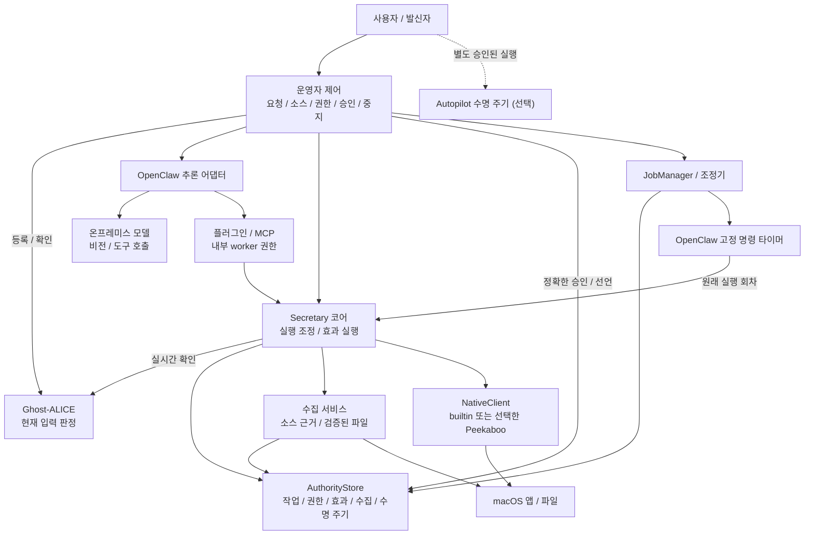

# AI Secretary

언어: [English](./README.md) | Korean

AI Secretary는 KakaoTalk과 WeChat을 포함한 여러 앱에서 로컬 데스크톱 작업을 수행하는 독립 [Ghost-ALICE](https://github.com/AidALL/ghost-alice) 애드온입니다. 비서 코어가 사용자 권한, 정확한 발신 승인, 대화 식별자, 검증된 수집, 타이머 선언과 데스크톱 효과를 소유합니다. 교체 가능한 OpenClaw 어댑터는 추론과 고정 명령 타이머를 제공하며, macOS 네이티브 도구는 독립 builtin 또는 명시적으로 선택한 Peekaboo 백엔드를 사용합니다. 앱별 API는 필수 조건이 아닙니다.

현재 애드온 소스 버전은 `0.1.0`이며, 공개 소스는 [AidALL/ghost-alice-ai-secretary](https://github.com/AidALL/ghost-alice-ai-secretary)입니다. 이 페이지에서 전체 운영 안내를 확인하실 수 있습니다. 구현 경계는 [Architecture](./ARCHITECTURE.md), 소스 라이선스는 [Apache-2.0](./LICENSE), 함께 구성되는 실행 환경의 라이선스는 [서드파티 고지](./THIRD_PARTY_NOTICES.md)를 참고해 주세요.

## 목차

- [시스템 한눈에 보기](#시스템-한눈에-보기)
- [필수 준비 사항](#필수-준비-사항)
- [전체 애드온 설치](#전체-애드온-설치)
- [첫 사용 전에 검토할 사항](#첫-사용-전에-검토할-사항)
- [첫 사용 준비 상태 확인](#첫-사용-준비-상태-확인)
- [온프레미스 모델 설정](#온프레미스-모델-설정)
- [엔드포인트와 실제 추론 확인](#엔드포인트와-실제-추론-확인)
- [macOS 권한 확인](#macos-권한-확인)
- [실제 작업 시작](#실제-작업-시작)
- [검증된 파일 수집](#검증된-파일-수집)
- [범위를 정한 예약 수집](#범위를-정한-예약-수집)
- [중지와 재시도](#중지와-재시도)
- [발신 작업 승인](#발신-작업-승인)
- [사용자 지정 경로, 재설치와 제거](#사용자-지정-경로-재설치와-제거)
- [개인정보와 현재 제한](#개인정보와-현재-제한)
- [개발 검증](#개발-검증)

## 시스템 한눈에 보기



화살표는 주요 제어·도구 경로를 보여 줍니다. 코어가 권한을 결정하고 효과를 기록하며, 네이티브 입력과 파일 검증은 별도 책임입니다. OpenClaw는 함께 제공하는 추론 경로와 선택해 재사용한 고정 명령 타이머를 제공합니다. 직접 운영자 호출과 MCP도 같은 코어를 사용하며, 상위 MCP 모델·네트워크는 자체 검토가 필요합니다. 예약 선언과 발신 승인은 운영자 동작입니다. Autopilot은 선택 사항이며 별도 승인이 필요합니다.

구현 전에 검토한 [구조 다이어그램](./ARCHITECTURE.md#component-dependencies)을 현재 구현의 권한·수집·타이머·재시작 계약에 맞춰 유지합니다. OpenClaw의 고정 명령 타이머를 실제로 재사용하고, 선택한 네이티브 백엔드에는 Peekaboo의 필요한 라이브러리와 공개한 전용 상태·입력 패치를 연결합니다. 기존 macOS 드라이버는 독립적으로 유지하며 기본값입니다. 설치와 실제 모델·앱 준비 상태는 각각 확인해 주세요.

## 필수 준비 사항

- macOS 14 이상, Python 3.11 이상과 Swift 컴파일러가 필요합니다.
- 설치된 Ghost-ALICE core와 실제 소스 체크아웃 경로가 필요합니다.
- 선택한 모델이 이미 설치된 온프레미스 Ollama 서버에 연결할 수 있어야 합니다. 모델 가중치와 모델 서버는 이 애드온과 별도로 준비해 주세요.
- GUI 작업에는 실제로 비전과 도구 호출을 지원하는 모델, 실행 환경의 macOS 접근성·화면 녹화 권한이 필요합니다.

Ghost-ALICE는 입력 원장과 현재 검사 판정을 제공합니다. [Autopilot](https://github.com/AidALL/ghost-alice-autopilot)은 별도의 승인된 실행 상태와 작업 지속 훅을 사용합니다. Secretary 설치가 Autopilot 실행을 승인하거나 활성화하지는 않습니다. 영문·국문 문서 구성은 Core와 Autopilot의 관례를 따르며, 운영 안내는 이 페이지에 함께 유지합니다.

## 전체 애드온 설치

`SECRETARY_GHOST_ROOT`를 실제 Ghost-ALICE 소스 체크아웃 경로로 설정한 뒤 이 애드온 체크아웃에서 설치해 주세요.

```sh
export SECRETARY_GHOST_ROOT="$HOME/ghost-alice"
git clone https://github.com/AidALL/ghost-alice-ai-secretary.git "$HOME/ghost-alice-ai-secretary"
cd "$HOME/ghost-alice-ai-secretary"
./scripts/install.sh --ghost-alice-root "$SECRETARY_GHOST_ROOT" --native-backend peekaboo
python3 scripts/installer.py status
```

위 명령은 Peekaboo를 명시적으로 선택하며 독립 builtin 도구도 유지합니다. 새 설치에서 builtin을 선택하려면 `--native-backend peekaboo`를 생략해 주세요. 재설치에는 선택한 백엔드 옵션을 다시 사용해 주세요. 설치기는 스킬, 비서 프로그램, 선택한 네이티브 도구와 라이선스 고지, 소유 worker·Python 실행기, OpenClaw `2026.9.8`과 Node `24.21.0`을 함께 구성합니다. 기본 경로는 프로그램 `~/.local/share/ai-secretary`, 스킬 `~/.agents/skills/ai-secretary`, 등록 기록 `~/.ghost-alice/addons/ai-secretary.json`입니다. 백그라운드 서비스를 시작하거나 모델 가중치를 설치하지 않으며, 추론 준비 완료를 입증하지도 않습니다. 이미 설치하셨다면 원래 설치 경로로 아래 준비 상태 확인을 진행해 주세요.

Core의 공식 `ai-secretary` 별칭은 [Core 통합 PR #47](https://github.com/AidALL/ghost-alice/pull/47)에서 준비 중이며 병합·배포를 기다리고 있습니다. 설치된 Core에서 해당 통합을 사용할 수 있기 전까지는 이 애드온의 설치기를 사용해 주세요. 기존 Core의 일반 `--addon-source` 경로는 스킬 내용을 설치하며, 이 전체 실행 환경을 구성하지 않습니다.

설치기는 최상위 OpenClaw 버전·npm 무결성과 Node 버전·배포 아카이브 체크섬을 확인합니다. 네트워크 설치는 npm 전이 의존성을 설치 시점에 해석하므로 전체 의존성 집합을 재현하는 잠금은 아닙니다. `--openclaw-source`와 `--node-source`는 개발 검증에 검증 가능한 고정 버전 캐시를 재사용하는 옵션입니다.

## 첫 사용 전에 검토할 사항

| 검토 영역 | 결정하거나 확인할 사항 |
| --- | --- |
| 운영자 결정: 모델과 네트워크 | 활성 온프레미스 URL과 정확한 모델 ID를 다시 확인해 주세요. 실제 비전·도구 호출·네트워크 격리와 상위 MCP 호스트·대체 모델·채널·텔레메트리를 검토해 주세요. provider 이름이나 설정 선언만으로 입증할 수는 없습니다. |
| 운영자 결정: 첫 작업 | 앱·창, 선택한 첨부파일이나 파일, 절대 목적지 경로와 관찰 가능한 성공 조건을 정해 주세요. 실제 저장 파일이나 앱 결과를 확인해 주세요. 설치·권한·프로토콜 검사는 서로 다른 단계를 입증합니다. |
| 발신자 결정: 정확한 발신 승인 | 저장된 계정·수신자·본문·첨부파일 해시·작성창 식별자·의도·초대 세부 정보를 검토한 뒤 정확한 digest를 승인해 주세요. 일반 데스크톱 권한은 발신을 승인하지 않습니다. |
| 구현 공백: 앱의 의미 | 실제 작성 화면이 승인한 초안과 일치하는지 확인하고 최종 효과를 관찰해 주세요. 발신 버튼 이름 검사만으로 모든 불투명한 앱의 의미나 작성 화면·초안의 일치를 입증할 수는 없습니다. |
| 구현 공백: 복구 | Gateway 중지 방법을 확인해 주세요. 로컬 클라이언트 중지만으로 Gateway 작업 중지를 입증할 수는 없습니다. 재시도 전에 실제 효과를 확인해 주세요. 살아 있는 원래 retrieval은 관찰·검증 등록을 재개할 수 있으며, 종료된 `Unknown` 복구는 수동입니다. 제거 전에 중지·정리와 소유 Gateway 종료를 진행해 주세요. |
| 배포 공백: Core 별칭 | 공식 별칭은 [PR #47](https://github.com/AidALL/ghost-alice/pull/47)에서 병합·배포를 기다리고 있습니다. 설치된 Core에 해당 통합이 전달되기 전까지는 이 애드온의 전체 설치기를 사용해 주세요. Secretary 설치가 선택 사항인 Autopilot 작업을 승인하지는 않습니다. |
| 앱별 검증 | 확인 근거를 실제로 검사한 앱과 작업 흐름에 한정해 주세요. 한 번의 범위가 정해진 작업 성공만으로 KakaoTalk·WeChat이나 다른 앱의 첨부파일·작성 화면·발신 동작을 입증할 수는 없습니다. |

## 첫 사용 준비 상태 확인

기본 설치에는 아래 실행기를 모든 관련 터미널에서 사용해 주세요. 사용자 지정 prefix로 설치하셨다면 원래 경로로 바꿔 주세요.

```sh
export SECRETARY_PREFIX="$HOME/.local/share/ai-secretary"
export PATH="$SECRETARY_PREFIX/managed/bin:$PATH"
openclaw config file
```

실행기는 `<prefix>/state/openclaw.json`과 `<prefix>/state/openclaw/`를 선택합니다. 기본 활성 설정 파일은 `~/.local/share/ai-secretary/state/openclaw.json`입니다. 관리 대상 템플릿인 `<prefix>/managed/config/openclaw.json` 대신 이 변경 가능한 상태 설정을 수정해 주세요. 기존 상태 설정은 재설치 시 보존되므로, 재설치가 엔드포인트나 모델 선택을 초기화하지 않습니다. 네이티브 백엔드·바이너리와 예약 실행기 경로는 별도 `<prefix>/state/secretary/runtime.json`에 저장하며, 관리 대상 `config/runtime.json`도 초기화 템플릿입니다.

| 확인 | 입증하는 범위 | 별도로 확인할 사항 |
| --- | --- | --- |
| `python3 scripts/installer.py status` | 설치기가 소유한 파일, 변경 여부와 등록 상태 | 모델·권한은 명시적으로 `not-checked`입니다. status는 잠금 안에서 중단된 설치를 복구할 수 있습니다. |
| `openclaw config validate` | 설정 스키마의 유효성 | 엔드포인트 연결, 모델 기능과 추론은 별도로 확인해 주세요. |
| `ai-secretary doctor` | 네이티브 접근성·화면 녹화 권한 값 | 설정한 모델과 실제 앱 동작은 별도입니다. `model_endpoint`는 고정된 localhost 안내이며, 연결 검사나 활성 설정 조회 결과가 아닙니다. |
| Ollama 모델 목록·상세 정보 | 엔드포인트 응답, 사용 가능한 모델 ID와 선언된 기능 | 실제 추론 응답과 GUI 동작은 별도로 확인해 주세요. |
| 작은 실제 추론 요청 | 선택한 서버·모델이 해당 요청에 응답하는지 | 비전, 도구 사용과 선택한 앱·파일의 결과는 별도로 확인해 주세요. |
| 선택한 앱에서 범위가 정해진 Secretary 작업 | 해당 앱·파일·요청에서 관찰한 결과 | 다른 앱과 작업 흐름은 별도의 확인 대상입니다. |

`installed` 상태나 권한 값 `true`가 표시되어도 모델 연결이 거부될 수 있습니다. 실제로 확인한 단계까지만 준비 상태를 판단해 주세요. 설치, Gateway 시작과 프로토콜 스모크 검사는 정상 모델 실행이나 파일 작업 성공을 입증하지 않습니다.

## 온프레미스 모델 설정

초기 템플릿은 `http://127.0.0.1:11434`와 `qwen3-vl:8b`를 선언합니다. 이는 기본값이며 실제 서버·모델이 있다는 근거가 아닙니다. 실제 온프레미스 네이티브 Ollama URL과 설치된 모델의 정확한 ID를 지정해 주세요. 서버의 네이티브 API 기본 URL을 사용하고 `/v1`이나 끝의 `/`를 붙이지 마세요. provider는 `ollama`로 유지합니다.

다음 세 설정이 서로 일치해야 합니다.

| 필드 | 값 |
| --- | --- |
| `models.providers.ollama.baseUrl` | 실제 온프레미스 Ollama 기본 URL |
| `models.providers.ollama.models[0].id` | 해당 서버가 제공하는 정확한 모델 ID |
| `agents.defaults.model.primary` | `ollama/` 뒤에 동일한 모델 ID를 붙인 값 |

Gateway가 실행 중이면 값을 변경하기 전에 포그라운드 Gateway를 중지해 주세요. 실행 전에 두 자리표시자를 실제 값으로 바꿔 주세요. Python이 값을 JSON으로 인코딩하고, 배치가 세 연동 필드를 함께 변경합니다.

```sh
export SECRETARY_OLLAMA_URL='http://YOUR_ON_PREM_HOST:11434'
export SECRETARY_MODEL_ID='YOUR_INSTALLED_VISION_TOOLS_MODEL'
SECRETARY_MODEL_CONFIG_JSON="$(python3 - "$SECRETARY_OLLAMA_URL" "$SECRETARY_MODEL_ID" <<'PY'
import json, sys
endpoint, model = sys.argv[1:]
print(json.dumps([
    {"path": "models.providers.ollama.baseUrl", "value": endpoint},
    {"path": "models.providers.ollama.models[0].id", "value": model},
    {"path": "agents.defaults.model.primary", "value": "ollama/" + model},
]))
PY
)"
openclaw config set --batch-json "$SECRETARY_MODEL_CONFIG_JSON" --strict-json --dry-run
```

dry run을 통과하고 값이 올바르면 같은 배치를 적용한 뒤 활성 설정을 다시 확인해 주세요.

```sh
openclaw config set --batch-json "$SECRETARY_MODEL_CONFIG_JSON" --strict-json
openclaw config get models.providers.ollama.baseUrl
openclaw config get 'models.providers.ollama.models[0].id'
openclaw config get agents.defaults.model.primary
openclaw config validate
```

zsh를 위해 대괄호 경로에 따옴표를 사용합니다. 이 명령은 고정 실행 환경의 JSON 배치 모드로 최종 설정을 검증하며, 검증 통과가 모델 호출을 의미하지는 않습니다. 함께 설치된 명령 참조는 `<prefix>/managed/openclaw/node_modules/openclaw/docs/cli/config.md`에 있고, 실행기·상태 경로 연결은 [설치기](./scripts/installer.py)에 있습니다. 나머지 모델 선언도 확인해 주세요. `input: ["text", "image"]`, 컨텍스트 크기와 출력 토큰 한도는 실제 선택한 모델과 맞아야 합니다. 설정에 `image`를 적어도 텍스트 전용 모델에 비전 기능이 생기지는 않습니다. 기존에 다른 모델 목록을 관리하고 계시면 관계없는 항목을 바꾸지 말고 사용하려는 항목을 일관되게 선택해 주세요.

## 엔드포인트와 실제 추론 확인

위에서 설정한 실제 엔드포인트·모델 변수를 그대로 사용해 주세요. [모델 목록 API](https://docs.ollama.com/api/tags)와 [모델 상세 API](https://docs.ollama.com/api-reference/show-model-details)로 가용성과 기능을 확인하실 수 있습니다.

```sh
curl --fail --silent --show-error "$SECRETARY_OLLAMA_URL/api/tags"
SECRETARY_SHOW_JSON="$(python3 - "$SECRETARY_MODEL_ID" <<'PY'
import json, sys
print(json.dumps({"model": sys.argv[1]}))
PY
)"
curl --fail --silent --show-error "$SECRETARY_OLLAMA_URL/api/show" \
  -H 'Content-Type: application/json' --data "$SECRETARY_SHOW_JSON"
```

정확한 모델이 목록에 있는지 확인하고 선언된 `vision`·`tools` 기능을 살펴봐 주세요. GUI 작업에는 해당 서버·모델에서 두 기능이 실제로 동작해야 하며, 목록이나 기능 선언만으로 충분하지 않습니다. 연결이 거부되면 진행하기 전에 사용할 온프레미스 서버를 준비하거나 시작해 주세요. 모델이 없거나 적합하지 않으면 서버 운영자에게 적합한 모델의 설치·선택을 요청하고 설정 확인을 반복해 주세요. [Ollama 설치](https://ollama.com/download/mac)와 [모델 목록](https://ollama.com/library)은 별도 서버 준비에 참고하실 수 있습니다.

[채팅 API](https://docs.ollama.com/api/chat)로 실제 텍스트 응답을 요청해 주세요. 이 진단은 앱 내용 없이 작은 프롬프트를 보냅니다.

```sh
SECRETARY_PROBE_JSON="$(python3 - "$SECRETARY_MODEL_ID" <<'PY'
import json, sys
print(json.dumps({"model": sys.argv[1], "stream": False,
    "messages": [{"role": "user", "content": "Reply with READY only."}]}))
PY
)"
curl --fail --silent --show-error "$SECRETARY_OLLAMA_URL/api/chat" \
  -H 'Content-Type: application/json' --data "$SECRETARY_PROBE_JSON"
```

돌아온 모델 응답과 오류를 확인해 주세요. HTTP 요청이 성공하고 실제 생성 내용이 있어야 해당 텍스트 추론을 확인한 것입니다. GUI 준비 완료를 판단하기 전에는 아래 앱 작업에서 실제 스크린샷 이해와 Secretary 도구 사용을 확인해 주세요.

## macOS 권한 확인

```sh
ai-secretary doctor
```

Doctor는 선택한 백엔드와 실제 기능 목록, `accessibility`와 `screen_recording`을 보고합니다. Peekaboo는 click·type·hotkey와 Secretary의 보호된 focus·open을 제공하며, drag·포인트 scroll은 builtin 기능입니다. 설치된 백엔드는 `ai-secretary backend peekaboo --binary "$SECRETARY_PREFIX/managed/app/build/desktop-secretary-peekaboo"` 또는 `ai-secretary backend builtin --binary "$SECRETARY_PREFIX/managed/app/build/desktop-secretary"`로 명시적으로 선택해 주세요. 선택은 변경 가능한 runtime 상태에 저장하며, 시작됐을 수 있는 효과를 다른 백엔드로 자동 재시도하지 않습니다. `accessibility`와 `screen_recording`을 확인해 주세요. 하나라도 false이면 macOS 시스템 설정 → 개인정보 보호 및 보안 → 손쉬운 사용 / 화면 기록에서 실행 환경에 권한을 허용한 뒤 같은 환경에서 다시 실행해 주세요. 현재 doctor의 `model_endpoint` localhost 문구는 활성 설정에 다른 온프레미스 서버를 지정해도 고정되어 있습니다. Doctor는 모델 연결, 모델 로딩이나 추론을 검사하지 않습니다.

## 실제 작업 시작

설정, 엔드포인트, 추론과 권한 확인을 마친 뒤 한 터미널에서 포그라운드 Gateway를 실행 상태로 유지해 주세요.

```sh
openclaw gateway run --bind loopback
```

두 번째 터미널에 같은 prefix와 PATH를 설정한 뒤 사용자 실행기에 실제 요청을 전달해 주세요. 예시의 앱·첨부파일·저장 위치는 선택한 실제 작업으로 바꿔 주세요.

```sh
export SECRETARY_PREFIX="$HOME/.local/share/ai-secretary"
export PATH="$SECRETARY_PREFIX/managed/bin:$PATH"
ai-secretary run --runtime openclaw \
  '위챗에서 내가 선택한 첨부파일을 내려받고, 지정한 폴더에 저장한 뒤 그 폴더를 열어 줘.'
```

첫 작업은 식별 가능한 앱·창, 실제 첨부파일이나 파일, 절대 저장 경로와 관찰 가능한 완료 조건으로 범위를 정해 주세요. 예를 들어 첨부파일 다운로드는 해당 경로에 저장된 파일과 내용을 확인한 뒤 완료로 판단해 주세요. 앱·파일이나 저장 위치가 정해지지 않은 작업은 실제 작업 흐름의 결과를 입증할 수 없습니다. KakaoTalk, WeChat과 다른 앱은 같은 관찰·조작 도구를 사용하지만 각 앱의 GUI 동작은 해당 앱에서 결과를 관찰해야 합니다.

`run`은 사용자가 직접 전달한 원래 텍스트를 Ghost-ALICE에 등록하고 현재 판정을 확인한 뒤 명시적인 대화 경로·UUID를 실행 환경에 전달합니다. 일반 후속 대화는 같은 대화와 TaskId를 유지하고, `run --new-task`는 별도 작업을 시작합니다. 기존 대화 UUID와 승인 기록은 보존됩니다. 현재 제공하는 추론 어댑터는 OpenClaw입니다. 개발 시 `--runtime-executable /absolute/path/to/openclaw`로 실행기를 선택할 수 있고, `--openclaw`도 호환 별칭으로 유지됩니다.

확인한 고정 CLI 경로는 네이티브 현재 요청·admission ID·출처 필드를 모두 제공하지 않으므로 사용자 작업에는 `ai-secretary run`을 사용해 주세요. 실제 필드를 제공하는 호스트는 네이티브 요청 등록을 사용할 수 있습니다. 조립된 프롬프트, 이전 대화, 도구 인자와 받은 문서는 새 사용자 작업을 등록하지 않습니다.

직접 도구나 MCP를 사용할 때는 같은 대화에 실제 사용자 작업을 먼저 등록해 주세요.

```sh
ai-secretary --session agent:main:secretary task '내가 지정한 다운로드 폴더의 파일을 확인해 줘.'
ai-secretary --session agent:main:secretary invoke secretary_files \
  --args-json '{"path":"/absolute/path/to/downloads"}'
```

네이티브 session ID가 있는 대화를 이어갈 때는 `--session`에 `sessionKey::sessionId`를 지정해 주세요. OpenClaw `/new`와 `/reset`은 네이티브 세션 식별자로 이전 작업을 분리합니다. 사용자 실행기 없이 오래된 세션을 재사용하는 경로는 현재 요청 연결을 보장하지 않습니다.

## 검증된 파일 수집

일반 포그라운드 컴퓨터 조작에는 등록된 작업이 있으면 됩니다. 범위가 정해진 반복 수집과 출처·커서 기록이 필요할 때 수집 소스를 설정해 주세요. 직접 수집과 고정 예약 레시피는 모델을 호출하지 않습니다.

로컬 폴더 소스에는 수집할 파일이 있는 폴더를 선택해 주세요. 아래 예시는 받은 파일용 폴더와 범위 설정 파일을 만듭니다. 폴더에는 사용하실 실제 파일을 넣어 주세요. 한도는 collect·ingest·resume 호출을 합친 원래 실행 전체에 적용합니다. 재사용한 파일 기록을 포함해 검증된 항목이 남은 한도를 사용하며, `filename_glob`은 상대 경로를 선택합니다.

```sh
export SECRETARY_INBOX="$HOME/Downloads/Secretary-Inbox"
mkdir -p "$SECRETARY_INBOX"
python3 - <<'PY'
import json, os
from pathlib import Path
Path("secretary-local-source.json").write_text(json.dumps({
    "root": os.environ["SECRETARY_INBOX"], "recipe": "local-snapshot",
    "filename_glob": "*", "max_items": 20, "max_bytes": 16777216
}))
PY
ai-secretary source configure inbox --kind local_files \
  --scope-file secretary-local-source.json
export SECRETARY_EXPIRY="$(python3 -c 'from datetime import datetime,timedelta,timezone; print((datetime.now(timezone.utc)+timedelta(days=1)).isoformat())')"
SECRETARY_GRANT_JSON="$(ai-secretary source grant inbox \
  --expires-at "$SECRETARY_EXPIRY" \
  --text "$SECRETARY_INBOX 폴더의 파일을 앞으로 하루 동안 15분마다 수집하고 로컬에 보관해 줘.")"
SECRETARY_GRANT_ID="$(python3 -c 'import json,sys; print(json.loads(sys.argv[1])["grant_id"])' "$SECRETARY_GRANT_JSON")"
ai-secretary collect "$SECRETARY_GRANT_ID"
ai-secretary artifacts --source-id inbox
```

실제 요청을 담은 `--text`는 별도의 `standing:<source>:<UUID>` 요청 등록을 만듭니다. 이후 일반 대화 입력이 해당 상시 업무의 권한을 바꾸지는 않습니다. `--text`를 생략하면 다른 제어 동작으로 처리됩니다. 선택한 `--session`의 현재 등록된 요청에 권한을 연결하므로, 현재 모델 작업이 수집할 소스에는 이 방식을 사용해 주세요. 모델은 어느 권한도 새로 만들거나 범위를 넓힐 수 없습니다. 모델 collect·ingest는 현재 worker의 정확한 session·admission·task·input에 연결된 권한을 요구합니다. 소스가 설정됐다는 이유로 별도 상시 업무의 권한을 가져올 수 없으며, 전용 상시 권한은 고정 타이머 또는 운영자 `collect GRANT_ID`가 실행합니다. 소스 개정은 물리적인 root·앱·계정·대화 식별자를 유지하며, 다른 물리적 소스에는 다른 source ID를 사용해 주세요. `ai-secretary source revoke inbox`로 권한을 철회할 수 있습니다.

검증된 파일 기록에는 내용 해시·크기·소스·항목 식별자와 출처가 있고, 실제 blob은 `<prefix>/state/secretary/artifacts`에 저장됩니다. 로컬 폴더 수집은 허용한 범위의 안정적인 파일 스냅샷을 확인하며, 다른 앱의 파일 생성이 끝났다는 사실을 증명하지는 않습니다.

### 데스크톱 첨부파일 레시피

`desktop-attachment-v1`은 여러 앱에 같은 일반 레시피를 사용합니다. 관찰한 앱에서 정확한 계정·대화·항목·다운로드 제어와 완료 상태 변화를 설정해 주세요. 앱이 무인 검증 수집에 충분한 근거를 제공하지 않더라도 일반 대화형 마우스·키보드 작업은 사용할 수 있습니다.

아래는 모든 필드를 갖춘 자체 테스트 창 형태의 범위 예시입니다. 실제 앱에서는 root와 관찰한 식별자·selector로 바꿔 주세요. 개발용 자체 테스트 창에는 이 문구가 실제로 있으며, 설치 대상에서 제외되고 폐기 가능한 테스트 파일만 만듭니다.

```json
{
  "root": "/absolute/path/to/downloads",
  "recipe": "desktop-attachment-v1",
  "app": "local.ai-secretary.fixture",
  "account": "fixture-account",
  "conversation": "fixture-conversation",
  "max_items": 1,
  "max_bytes": 1048576,
  "desktop": {
    "app_selector": {"field": "bundle_id", "equals": "local.ai-secretary.fixture"},
    "window_title": "AI Secretary Self-Owned Test Fixture",
    "account_selector": {"role": "AXStaticText", "identifier": "fixture-account", "text": "fixture-account"},
    "conversation_selector": {"role": "AXStaticText", "identifier": "fixture-conversation", "text": "fixture-conversation"},
    "items": [{
      "item_id": "attachment-1",
      "item_selector": {"role": "AXStaticText", "identifier": "fixture-item", "text": "Attachment: fixture-download.txt"},
      "download_selector": {"role": "AXButton", "identifier": "fixture-download", "text": "Download Synthetic File"},
      "filename": "fixture-download.txt",
      "completion": {
        "before": {"role": "AXStaticText", "identifier": "fixture-status", "text": "No download yet"},
        "after": {"role": "AXStaticText", "identifier": "fixture-status", "text": "Downloaded: fixture-download.txt"}
      }
    }]
  }
}
```

실제 앱에 맞춘 범위를 `secretary-desktop-source.json`으로 저장하고 `ai-secretary source configure selected-attachments --kind desktop_attachments --scope-file secretary-desktop-source.json`을 실행해 주세요. 실제 요청으로 권한을 부여한 뒤 반환된 grant ID로 수집합니다. before·after selector는 같은 표시 노드를 가리켜야 하며, after 문구에는 정확한 파일명이 있어야 합니다. 항목의 선택 필드 `expected_size`와 `expected_sha256`으로 완료 근거를 보강할 수 있습니다. 기존에 같은 이름으로 있던 파일이나 파일 출현만으로는 통과하지 않습니다.

다운로드가 지연되면 원래 retrieval과 operation을 유지합니다. 원래 권한이 유효한 동안 `ai-secretary source list`의 `active_run_id`와 `unresolved_retrieval_id`를 확인하고 `ai-secretary collect GRANT_ID --run-id ORIGINAL_RUN_ID` 또는 `ai-secretary ingest ORIGINAL_RUN_ID ORIGINAL_RETRIEVAL_ID /absolute/original/file`을 사용해 주세요. 두 경로는 다운로드 입력을 다시 하지 않고 원래 후보를 관찰·검증·등록합니다. 항목 하나의 검증은 해당 커서만 전진시킵니다. 원래 저장한 항목이 남거나 소스의 불확실성이 해결되지 않으면 전체 실행은 `Pending`을 유지하며, 명시적인 collect가 새로운 검사를 거쳐 원래 항목 집합을 계속합니다. 중지·철회·프로세스 비정상 종료로 종료된 `Unknown`에는 이 살아 있는 실행의 재개 경로를 적용할 수 없습니다.

모델 도구는 `secretary_collect({"source_id":"…"})`, `secretary_ingest({"source_id":"…","retrieval_id":"…","path":"…"})`, `secretary_artifacts({"source_id":"…"})`입니다. 실행 식별자는 호스트가 내부에서 결정하며, 모델 인자로 grant·session·완료 판정·권한 기록을 전달할 수 없습니다.

## 범위를 정한 예약 수집

위 안내대로 소유한 포그라운드 Gateway를 유지하고 수집에 사용한 터미널도 열어 두세요. 같은 prefix·PATH를 사용하는 다른 터미널에서 Secretary 조정기를 명시적으로 시작해 주세요.

```sh
ai-secretary schedule start
```

`SECRETARY_GRANT_ID`가 설정된 원래 수집 터미널로 돌아와 한도가 있는 예약 업무를 선언해 주세요.

```sh
SECRETARY_JOB_JSON="$(ai-secretary schedule create "$SECRETARY_GRANT_ID" \
  --every 900 --max-runs 96 --max-lateness 60 --misfire skip)"
SECRETARY_JOB_ID="$(python3 -c 'import json,sys; print(json.loads(sys.argv[1])["job_id"])' "$SECRETARY_JOB_JSON")"
ai-secretary schedule list
ai-secretary schedule reconcile
```

일회성 예약은 `--every` 대신 시간대가 있는 ISO 시각으로 `--at`을 사용해 주세요. 반복 간격에는 `--start-at`으로 기준 시각을 지정할 수 있습니다. 예약은 권한 만료 시각 안에서만 유효합니다. 놓친 실행 처리에는 `skip`과 `coalesce`를 지원하며, 달력형 cron 표현식은 지원하지 않습니다.

조정기가 고정 명령을 갖는 실행 한 차례씩을 등록하고 저장된 선언을 복구하며, OpenClaw가 실제 시각에 실행합니다. 모델을 호출하거나 메시지·실패 알림을 보내지 않습니다. 설치만으로 두 프로세스를 시작하거나 예약 업무를 허용하지는 않습니다. `ai-secretary schedule cancel "$SECRETARY_JOB_ID"`는 업무 하나를 철회하고, `ai-secretary schedule stop`은 관계없는 포그라운드 작업을 유지하면서 예약 수명 주기와 소유한 타이머를 중지합니다.

원격 생성 결과가 불확실할 때 목록이 비어 있다는 이유로 다시 생성하지 않습니다. 늦게 생성된 타이머도 로컬 취소 이후까지 소유한 정리 의무로 남습니다. 확인되지 않은 생성 작업이나 미완료 정리는 `Draining` 상태와 제거 차단으로 이어지므로, 상태와 조정에 필요한 소유 도구를 유지해 주세요.

## 중지와 재시도

예약 수집만 중지하려면 `ai-secretary schedule stop`을 사용해 주세요. 재시도나 애드온 제거 전에 소유한 모든 실행 수명 주기의 권한을 무효화하고 정리하려면 `ai-secretary stop`을 사용해 주세요. 반환된 `Stopped` 또는 `Draining` 상태를 확인해 주세요. 중지는 권한 무효화를 먼저 기록한 뒤 데스크톱·네이티브·타이머 생성 작업의 종료를 기다리며, 불확실한 효과와 정리 의무를 보존합니다.

포그라운드 Gateway는 해당 터미널에서 Ctrl-C를 누르고 종료를 기다려 주세요. `ai-secretary run`의 Ctrl-C는 로컬 클라이언트를 정리하며, Gateway 작업 중지를 입증하지 않습니다. 재설치·제거 전에는 소유 클라이언트·조정기 프로세스와 소유 Gateway를 종료해 주세요. 설치기는 실행 자원 소유와 저장된 종료 상태를 확인하고 정리가 남으면 제거를 거부합니다. 중지를 자동으로 완료하거나 불확실한 원격 생성을 해결하지는 않습니다.

효과를 반복하기 전에 실제 파일·작성창·발신 결과를 확인해 주세요. 같은 효과의 `Applied` OperationId는 기록된 결과를 재사용하며 다른 효과에 재사용할 수 없습니다. 효과가 없었다고 입증된 실패는 원래 의도한 operation으로 재시도할 수 있습니다. `Applying`이나 `Unknown`에서 무작정 재시도하거나 새 operation ID를 만들어서는 안 됩니다. 일반 OS 입력 전달은 파일 저장·메시지 발신을 입증하지 않습니다.

살아 있는 첨부파일 실행이 자기 소유의 미확인 retrieval을 갖고 있으면 결과 확인 권한과 소스 점유를 유지합니다. 위 원래 실행의 collect·ingest 명령을 사용하고 다시 클릭하지 마세요. 프로세스 비정상 종료·중지·철회 이후 종료된 불확실한 실행에는 현재 자동 해결기가 없습니다. 기록을 보존하고 실제 근거에 따른 운영자 복구를 진행해 주세요.

## 발신 작업 승인

사용자가 발신자이며 정확한 초안을 승인합니다. Secretary는 `secretary_draft`에 계정·수신자·본문·첨부파일 내용 해시·정확한 `composer: {pid, process_start, window_id}`·`intent`·초대 세부사항을 저장한 뒤 초안을 보여 줍니다. 사용자의 대화형 터미널에서 저장된 초안과 실제 digest를 검토해 주세요.

```sh
ai-secretary approve ACTUAL_DRAFT_ID --digest ACTUAL_DRAFT_DIGEST
```

발신 동작에는 승인된 정확한 `outbound: {draft_id, content}`를 전달하며, 관찰한 대상은 해당 composer와 일치해야 합니다. 명령은 저장된 기록을 출력하고 `APPROVE ACTUAL_DRAFT_DIGEST` 입력을 요청합니다. 자리표시자는 저장된 실제 값으로 바꿔 주세요. 초안이 바뀌면 승인이 무효화되고, 발신 전에 실제 앱 작성창과 승인된 내용이 일치해야 합니다. 일반적인 컴퓨터 조작 권한은 메시지·답장·초대 발신을 허용하지 않습니다. 등록한 작업 안의 읽기, 다운로드, 폴더 열기와 초안 준비에는 클릭마다 승인을 요구하지 않습니다.

발신 버튼 이름 검사는 보조 장치입니다. 모든 불투명한 GUI 의미를 인식하거나 작성창과 승인 초안의 일치를 자동으로 증명하지는 않습니다. 시각 판단, 사용자의 정확한 승인과 최종 효과 관찰이 함께 필요합니다.

## 사용자 지정 경로, 재설치와 제거

status, 재설치와 제거에는 원래 prefix·스킬 디렉터리·등록 경로 선택을 유지해 주세요. 아래 예시는 모든 작업에서 같은 변수를 재사용합니다. 기존 설치를 이 예시 경로로 가져오지 말고 실제 설치 경로를 지정해 주세요.

```sh
export SECRETARY_GHOST_ROOT='/absolute/path/to/ghost-alice'
export SECRETARY_PREFIX='/absolute/path/to/ai-secretary'
export SECRETARY_SKILLS_DIR='/absolute/path/to/skills'
export SECRETARY_REGISTRY_DIR='/absolute/path/to/addons'
./scripts/install.sh --ghost-alice-root "$SECRETARY_GHOST_ROOT" \
  --prefix "$SECRETARY_PREFIX" --skills-dir "$SECRETARY_SKILLS_DIR" \
  --registry-dir "$SECRETARY_REGISTRY_DIR"
python3 scripts/installer.py status --ghost-alice-root "$SECRETARY_GHOST_ROOT" \
  --prefix "$SECRETARY_PREFIX" --skills-dir "$SECRETARY_SKILLS_DIR" \
  --registry-dir "$SECRETARY_REGISTRY_DIR"
```

선택한 업데이트 소스 체크아웃에서 같은 경로로 재설치해 주세요.

```sh
./scripts/install.sh --ghost-alice-root "$SECRETARY_GHOST_ROOT" \
  --prefix "$SECRETARY_PREFIX" --skills-dir "$SECRETARY_SKILLS_DIR" \
  --registry-dir "$SECRETARY_REGISTRY_DIR"
```

해당 설치를 제거하려면 다음 명령을 사용해 주세요.

```sh
./scripts/uninstall.sh --ghost-alice-root "$SECRETARY_GHOST_ROOT" \
  --prefix "$SECRETARY_PREFIX" --skills-dir "$SECRETARY_SKILLS_DIR" \
  --registry-dir "$SECRETARY_REGISTRY_DIR"
```

제거 전에는 위 중지·정리와 소유 Gateway 종료를 완료해 주세요. 남은 실행 권한·네이티브 소유·타이머·불확실한 생성 작업은 삭제를 차단하며 설치된 정리 도구를 보존합니다. 기본 경로에는 `./scripts/uninstall.sh`를 사용해 주세요. 제거는 변경되지 않은 소유 프로그램·스킬·등록 리소스를 대상으로 합니다. 사용자 수정, 기존 미소유 리소스, 작업 원장, OpenClaw 대화와 모델 설정은 보존됩니다. 변경된 등록 기록은 프로그램·스킬 삭제 전에 제거를 차단합니다. 부분 제거는 소유권 근거와 재시도 명령을 유지하고 보존된 파일을 알립니다. 재설치에는 잠금·스테이징·롤백·중단 설치 복구가 적용되며, `status`도 잠금 안에서 복구 경로에 진입합니다.

여러 스킬 위치에는 `--skills-dir`를 반복해 주세요. `--claude`는 Claude 스킬 디렉터리도 추가하므로 최초 설치에 사용했다면 이후 작업에도 재사용해 주세요. Core의 플랫폼 등록 경로를 명시적으로 선택하려면 해당 스킬 디렉터리와 함께 `--platform-registry codex=/absolute/dir`, `--platform-registry claude=/absolute/dir`를 반복해 주세요. `--platform-registry`와 `--registry-dir`는 함께 사용하지 마세요. 이후 status·재설치·제거에 정확한 원래 플랫폼·스킬 선택을 사용해 주세요. 기록된 등록 경로 선택을 바꾸려면 기존 선택으로 제거한 뒤 새 선택으로 설치해야 하며, 작업·대화 상태는 보존됩니다.

공식 다중 플랫폼 설치는 한 공유 번들입니다. 등록된 플랫폼 하나에서 제거를 요청하면 번들과 그 번들이 소유한 모든 플랫폼 등록·스킬이 제거됩니다. 다른 애드온과 개인 작업 데이터는 해당 제거 범위에 포함되지 않습니다.

## 개인정보와 현재 제한

개인 메시지·첨부파일·화면은 확인된 온프레미스 모델 경로에 유지해 주세요. 해당 내용을 전달하는 외부 모델 fallback, 채널이나 telemetry 경로를 설정하지 마세요. 기본 프로필은 Secretary 도구를 허용하고 일반 실행 환경 도구를 비활성화합니다. 기준 경로 정책은 `src/ai_secretary/resources/model-policy.json`이며 현재 선언된 Ollama provider를 허용합니다. `ollama`라는 이름은 URL·서버·모델 실행·네트워크가 온프레미스에 있다는 증거가 아닙니다. 실제 엔드포인트와 네트워크 격리를 확인해 주세요. MCP를 사용하는 상위 호스트도 자체 모델·네트워크 검토가 필요합니다.

이 구현은 최신 창·프로세스 보호와 데스크톱 효과 기록으로 여러 macOS GUI 작업을 다룹니다. 모든 불투명한 앱 의미, 작성창·초안 동등성이나 `Unknown` 조정을 자동으로 입증하지는 않습니다. 실제 모델 추론과 KakaoTalk·WeChat 첨부파일 작업은 설치·프로토콜 검사와 별도의 검증 대상입니다. 이식 가능한 Python 코어만으로 다른 운영체제의 데스크톱 지원을 입증할 수는 없습니다.

## 개발 검증

저장소에는 코어 계약, 패키지 단독 실행, 프로토콜, 설치·제거와 선택적으로 실행하는 실제 macOS 자체 테스트 창 검사가 포함되어 있습니다. 일반 단위 테스트는 실제 창 검사를 명시적으로 건너뜁니다. Gateway 스모크는 내부 실행 세션에 연결되지 않은 직접 HTTP 도구 호출이 거부되는지 확인하며, 입력 등록·미등록·현재 Ghost-ALICE 차단 조건은 별도로 검사합니다. 에이전트 하네스는 로컬 프로토콜 스텁으로 정상적인 실행 세션에서 네이티브 권한 상태까지 이어지는 흐름을 검사합니다. 두 검사 모두 LLM 성능이나 실제 협업 앱 작업 흐름을 입증하지 않습니다.

`SECRETARY_GHOST_ROOT`는 설치된 Ghost-ALICE 소스 경로이며 기본값은 `~/ghost-alice`입니다. `SECRETARY_NODE`는 Node를 선택하고 기본값은 PATH입니다. 설치된 전용 Node를 지정하면 스모크 실행 환경을 명확하게 선택하실 수 있습니다.

```sh
export SECRETARY_GHOST_ROOT="$HOME/ghost-alice"
export SECRETARY_NODE="$HOME/.local/share/ai-secretary/managed/node/bin/node"
./scripts/build_native.sh --backend all --test-window
PYTHONPATH=src python3 -m unittest discover -s tests -v
AI_SECRETARY_NATIVE_BINARY=build/desktop-secretary PYTHONPATH=src \
  python3 -m unittest discover -s tests -p test_native.py -v
```

선택한 제품을 검사하려면 같은 네이티브 테스트 명령에 `AI_SECRETARY_NATIVE_BACKEND=peekaboo`와 `AI_SECRETARY_NATIVE_BINARY=build/desktop-secretary-peekaboo`를 지정해 주세요. 마지막 명령은 테스트 창을 잠시 열어 실제 입력·저장·스크린샷을 검사합니다. 이 테스트 창으로 협업 앱 동작을 입증하지는 않습니다. 모델 추론 없이 고정 실행 환경을 검사하려면 결과를 로컬 임시 경로에 유지해 주세요.

```sh
python3 scripts/smoke_openclaw.py \
  --runtime "$HOME/.local/share/ai-secretary/managed/openclaw" --output .tmp/gateway-smoke
python3 scripts/smoke_agent_harness.py \
  --runtime "$HOME/.local/share/ai-secretary/managed/openclaw" \
  --output .tmp/agent-harness --admission-mode user-run
```


2026-10-09의 범위가 정해진 소스 검증에서는 실제 Peekaboo Unicode 입력·클릭·파일 생성·창 캡처, 일반 데스크톱 레시피의 58바이트 파일 검증, 미래 시각의 Gateway 고정 명령 타이머를 통한 48바이트 로컬 파일 검증과 소유 원격 타이머 잔여 0건을 확인했습니다.

별도의 폐기 가능한 prefix 설치에서는 설정 검증·스킬 인식·플러그인 로딩을 통과했습니다. 현재 설치된 Peekaboo 바이너리는 04:13:13 UTC에 실제 focus·클릭·Unicode 입력·다운로드·창 스크린샷과 변조된 관찰 거부를 검사하여, 건너뛰기 없이 두 테스트를 통과했습니다. 설치된 일반 레시피의 검증된 58바이트 파일은 원래 04:04:11 UTC 근거를 유지하며, 설정 루트 경계 수정 뒤 해당 수집 근거를 재사용했습니다. 04:14:52 UTC에는 설치기가 소유한 Python 실행기와 Gateway가 미래 시각의 고정 명령 타이머를 완료하고 45바이트 파일을 검증했으며, 소유 원격 타이머 잔여 0건과 예약 수명 주기의 `Stopped`를 확인했습니다. 클라이언트 실행 중 제거 시도는 거부되었습니다. 소유 Gateway와 수명 주기를 중지한 뒤 04:16:48 UTC에 독립 설치의 제거를 통과하여, 소유한 관리 파일·스킬·등록만 제거하고 상태 파일 580개와 다른 스킬·등록 리소스를 그대로 보존했습니다. 이 비교에서는 일시적인 SQLite WAL/SHM 파일을 제외했습니다. 폐기 가능한 로컬 데이터를 사용했으며 메시지나 추론을 실행하지 않았습니다. 독립 설치의 해당 경로를 확인한 결과이며, 실제 온프레미스 추론·KakaoTalk·WeChat 작업과 사용자 일반 설치의 제거·갱신 완료는 자체 근거가 필요합니다. 네이티브 status의 검증 표시 필드는 이 외부 테스트 기록을 읽지 않습니다.
