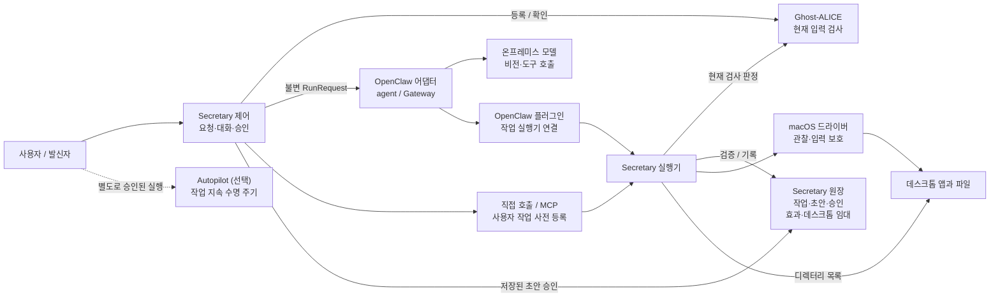

# AI Secretary

언어: [English](./README.md) | Korean

AI Secretary는 KakaoTalk과 WeChat을 포함한 여러 앱에서 로컬 데스크톱 작업을 수행하는 독립 [Ghost-ALICE](https://github.com/AidALL/ghost-alice) 애드온입니다. 비서 코어가 실제 사용자 요청 등록, 정확한 발신 승인, 대화 식별자와 데스크톱 효과 기록을 소유합니다. 교체 가능한 OpenClaw 어댑터가 추론을 실행하고, macOS 네이티브 도구가 창·마우스·키보드·파일을 관찰하고 조작합니다. 앱별 API는 필수 조건이 아닙니다.

현재 애드온 소스 버전은 `0.1.0`이며, 공개 소스는 [AidALL/ghost-alice-ai-secretary](https://github.com/AidALL/ghost-alice-ai-secretary)입니다. 이 페이지에서 전체 운영 안내를 확인하실 수 있습니다. 구현 경계는 [Architecture](./ARCHITECTURE.md), 소스 라이선스는 [Apache-2.0](./LICENSE), 함께 구성되는 실행 환경의 라이선스는 [서드파티 고지](./THIRD_PARTY_NOTICES.md)를 참고해 주세요.

## 목차

- [시스템 한눈에 보기](#시스템-한눈에-보기)
- [필수 준비 사항](#필수-준비-사항)
- [전체 애드온 설치](#전체-애드온-설치)
- [첫 사용 전에 검토할 사항](#첫-사용-전에-검토할-사항)
- [첫 사용 준비 상태 확인](#첫-사용-준비-상태-확인)
- [온프레미스 모델 설정](#온프레미스-모델-설정)
- [엔드포인트와 실제 추론 확인](#엔드포인트와-실제-추론-확인)
- [macOS 권한 확인](#macos-권한-확인)
- [실제 작업 시작](#실제-작업-시작)
- [중지와 재시도](#중지와-재시도)
- [발신 작업 승인](#발신-작업-승인)
- [사용자 지정 경로, 재설치와 제거](#사용자-지정-경로-재설치와-제거)
- [개인정보와 현재 제한](#개인정보와-현재-제한)
- [개발 검증](#개발-검증)

## 시스템 한눈에 보기



화살표는 요청·도구·승인 호출을 나타냅니다. 도구 실행기가 네이티브 드라이버를 호출하며, 원장은 권한과 기록을 제공합니다. 함께 제공되는 추론 경로는 OpenClaw입니다. 직접 호출과 MCP는 이 어댑터를 거치지 않고 같은 실행기에 연결되며, 상위 호스트의 모델·네트워크를 별도로 검토하셔야 합니다. 파일 목록 조회는 Python에서 실행합니다. Autopilot은 선택 사항이며 별도 승인이 필요합니다. Secretary 설치로 활성화되지는 않습니다. 컴포넌트 의존성과 동작·재시도 흐름은 [Architecture](./ARCHITECTURE.md)를 참고해 주세요.

## 필수 준비 사항

- macOS 14 이상, Python 3.11 이상과 Swift 컴파일러가 필요합니다.
- 설치된 Ghost-ALICE core와 실제 소스 체크아웃 경로가 필요합니다.
- 선택한 모델이 이미 설치된 온프레미스 Ollama 서버에 연결할 수 있어야 합니다. 모델 가중치와 모델 서버는 이 애드온과 별도로 준비해 주세요.
- GUI 작업에는 실제로 비전과 도구 호출을 지원하는 모델, 실행 환경의 macOS 접근성·화면 녹화 권한이 필요합니다.

Ghost-ALICE는 입력 원장과 현재 검사 판정을 제공합니다. [Autopilot](https://github.com/AidALL/ghost-alice-autopilot)은 별도의 승인된 실행 상태와 작업 지속 훅을 사용합니다. Secretary 설치가 Autopilot 실행을 승인하거나 활성화하지는 않습니다. 영문·국문 문서 구성은 Core와 Autopilot의 관례를 따르며, 운영 안내는 이 페이지에 함께 유지합니다.

## 전체 애드온 설치

`SECRETARY_GHOST_ROOT`를 실제 Ghost-ALICE 소스 체크아웃 경로로 설정한 뒤 이 애드온 체크아웃에서 설치해 주세요.

```sh
export SECRETARY_GHOST_ROOT="$HOME/ghost-alice"
git clone https://github.com/AidALL/ghost-alice-ai-secretary.git "$HOME/ghost-alice-ai-secretary"
cd "$HOME/ghost-alice-ai-secretary"
./scripts/install.sh --ghost-alice-root "$SECRETARY_GHOST_ROOT"
python3 scripts/installer.py status
```

설치기는 스킬, 비서 프로그램, 네이티브 도구, OpenClaw `2026.9.8`과 Node `24.21.0`을 함께 구성합니다. 기본 경로는 프로그램 `~/.local/share/ai-secretary`, 스킬 `~/.agents/skills/ai-secretary`, 등록 기록 `~/.ghost-alice/addons/ai-secretary.json`입니다. 백그라운드 서비스를 시작하거나 모델 가중치를 설치하지 않으며, 추론 준비 완료를 입증하지도 않습니다. 이미 설치하셨다면 원래 설치 경로로 아래 준비 상태 확인을 진행해 주세요.

Core의 공식 `ai-secretary` 별칭은 [Core 통합 PR #47](https://github.com/AidALL/ghost-alice/pull/47)에서 준비 중이며 병합·배포를 기다리고 있습니다. 설치된 Core에서 해당 통합을 사용할 수 있기 전까지는 이 애드온의 설치기를 사용해 주세요. 기존 Core의 일반 `--addon-source` 경로는 스킬 내용을 설치하며, 이 전체 실행 환경을 구성하지 않습니다.

설치기는 최상위 OpenClaw 버전·npm 무결성과 Node 버전·배포 아카이브 체크섬을 확인합니다. 네트워크 설치는 npm 전이 의존성을 설치 시점에 해석하므로 전체 의존성 집합을 재현하는 잠금은 아닙니다. `--openclaw-source`와 `--node-source`는 개발 검증에 검증 가능한 고정 버전 캐시를 재사용하는 옵션입니다.

## 첫 사용 전에 검토할 사항

| 검토 영역 | 결정하거나 확인할 사항 |
| --- | --- |
| 운영자 결정: 모델과 네트워크 | 활성 온프레미스 URL과 정확한 모델 ID를 다시 확인해 주세요. 실제 비전·도구 호출·네트워크 격리와 상위 MCP 호스트·대체 모델·채널·텔레메트리를 검토해 주세요. provider 이름이나 설정 선언만으로 입증할 수는 없습니다. |
| 운영자 결정: 첫 작업 | 앱·창, 선택한 첨부파일이나 파일, 절대 목적지 경로와 관찰 가능한 성공 조건을 정해 주세요. 실제 저장 파일이나 앱 결과를 확인해 주세요. 설치·권한·프로토콜 검사는 서로 다른 단계를 입증합니다. |
| 발신자 결정: 정확한 발신 승인 | 저장된 계정·수신자·본문·첨부파일 해시·초대 세부 정보를 검토한 뒤 정확한 digest를 승인해 주세요. 일반 데스크톱 권한은 발신을 승인하지 않습니다. |
| 구현 공백: 앱의 의미 | 실제 작성 화면이 승인한 초안과 일치하는지 확인하고 최종 효과를 관찰해 주세요. 발신 버튼 이름 검사만으로 모든 불투명한 앱의 의미나 작성 화면·초안의 일치를 입증할 수는 없습니다. |
| 구현 공백: 복구 | Gateway 중지 방법을 확인해 주세요. 로컬 클라이언트 중지만으로 Gateway 작업 중지를 입증할 수는 없습니다. 재시도 전에 실제 효과를 확인해 주세요. `Applying` 또는 `Unknown`은 근거에 따른 결과 확인·정리가 필요하며 자동화되어 있지 않습니다. |
| 배포 공백: Core 별칭 | 공식 별칭은 [PR #47](https://github.com/AidALL/ghost-alice/pull/47)에서 병합·배포를 기다리고 있습니다. 설치된 Core에 해당 통합이 전달되기 전까지는 이 애드온의 전체 설치기를 사용해 주세요. Secretary 설치가 선택 사항인 Autopilot 작업을 승인하지는 않습니다. |
| 앱별 검증 | 확인 근거를 실제로 검사한 앱과 작업 흐름에 한정해 주세요. 한 번의 범위가 정해진 작업 성공만으로 KakaoTalk·WeChat이나 다른 앱의 첨부파일·작성 화면·발신 동작을 입증할 수는 없습니다. |

## 첫 사용 준비 상태 확인

기본 설치에는 아래 실행기를 모든 관련 터미널에서 사용해 주세요. 사용자 지정 prefix로 설치하셨다면 원래 경로로 바꿔 주세요.

```sh
export SECRETARY_PREFIX="$HOME/.local/share/ai-secretary"
export PATH="$SECRETARY_PREFIX/managed/bin:$PATH"
openclaw config file
```

실행기는 `<prefix>/state/openclaw.json`과 `<prefix>/state/openclaw/`를 선택합니다. 기본 활성 설정 파일은 `~/.local/share/ai-secretary/state/openclaw.json`입니다. 관리 대상 템플릿인 `<prefix>/managed/config/openclaw.json` 대신 이 변경 가능한 상태 설정을 수정해 주세요. 기존 상태 설정은 재설치 시 보존되므로, 재설치가 엔드포인트나 모델 선택을 초기화하지 않습니다.

| 확인 | 입증하는 범위 | 별도로 확인할 사항 |
| --- | --- | --- |
| `python3 scripts/installer.py status` | 설치기가 소유한 파일, 변경 여부와 등록 상태 | 모델·권한은 명시적으로 `not-checked`입니다. status는 잠금 안에서 중단된 설치를 복구할 수 있습니다. |
| `openclaw config validate` | 설정 스키마의 유효성 | 엔드포인트 연결, 모델 기능과 추론은 별도로 확인해 주세요. |
| `ai-secretary doctor` | 네이티브 접근성·화면 녹화 권한 값 | 설정한 모델과 실제 앱 동작은 별도입니다. `model_endpoint`는 고정된 localhost 안내이며, 연결 검사나 활성 설정 조회 결과가 아닙니다. |
| Ollama 모델 목록·상세 정보 | 엔드포인트 응답, 사용 가능한 모델 ID와 선언된 기능 | 실제 추론 응답과 GUI 동작은 별도로 확인해 주세요. |
| 작은 실제 추론 요청 | 선택한 서버·모델이 해당 요청에 응답하는지 | 비전, 도구 사용과 선택한 앱·파일의 결과는 별도로 확인해 주세요. |
| 선택한 앱에서 범위가 정해진 Secretary 작업 | 해당 앱·파일·요청에서 관찰한 결과 | 다른 앱과 작업 흐름은 별도의 확인 대상입니다. |

`installed` 상태나 권한 값 `true`가 표시되어도 모델 연결이 거부될 수 있습니다. 실제로 확인한 단계까지만 준비 상태를 판단해 주세요. 설치, Gateway 시작과 프로토콜 스모크 검사는 정상 모델 실행이나 파일 작업 성공을 입증하지 않습니다.

## 온프레미스 모델 설정

초기 템플릿은 `http://127.0.0.1:11434`와 `qwen3-vl:8b`를 선언합니다. 이는 기본값이며 실제 서버·모델이 있다는 근거가 아닙니다. 실제 온프레미스 네이티브 Ollama URL과 설치된 모델의 정확한 ID를 지정해 주세요. 서버의 네이티브 API 기본 URL을 사용하고 `/v1`이나 끝의 `/`를 붙이지 마세요. provider는 `ollama`로 유지합니다.

다음 세 설정이 서로 일치해야 합니다.

| 필드 | 값 |
| --- | --- |
| `models.providers.ollama.baseUrl` | 실제 온프레미스 Ollama 기본 URL |
| `models.providers.ollama.models[0].id` | 해당 서버가 제공하는 정확한 모델 ID |
| `agents.defaults.model.primary` | `ollama/` 뒤에 동일한 모델 ID를 붙인 값 |

Gateway가 실행 중이면 값을 변경하기 전에 포그라운드 Gateway를 중지해 주세요. 실행 전에 두 자리표시자를 실제 값으로 바꿔 주세요. Python이 값을 JSON으로 인코딩하고, 배치가 세 연동 필드를 함께 변경합니다.

```sh
export SECRETARY_OLLAMA_URL='http://YOUR_ON_PREM_HOST:11434'
export SECRETARY_MODEL_ID='YOUR_INSTALLED_VISION_TOOLS_MODEL'
SECRETARY_MODEL_CONFIG_JSON="$(python3 - "$SECRETARY_OLLAMA_URL" "$SECRETARY_MODEL_ID" <<'PY'
import json, sys
endpoint, model = sys.argv[1:]
print(json.dumps([
    {"path": "models.providers.ollama.baseUrl", "value": endpoint},
    {"path": "models.providers.ollama.models[0].id", "value": model},
    {"path": "agents.defaults.model.primary", "value": "ollama/" + model},
]))
PY
)"
openclaw config set --batch-json "$SECRETARY_MODEL_CONFIG_JSON" --strict-json --dry-run
```

dry run을 통과하고 값이 올바르면 같은 배치를 적용한 뒤 활성 설정을 다시 확인해 주세요.

```sh
openclaw config set --batch-json "$SECRETARY_MODEL_CONFIG_JSON" --strict-json
openclaw config get models.providers.ollama.baseUrl
openclaw config get 'models.providers.ollama.models[0].id'
openclaw config get agents.defaults.model.primary
openclaw config validate
```

zsh를 위해 대괄호 경로에 따옴표를 사용합니다. 이 명령은 고정 실행 환경의 JSON 배치 모드로 최종 설정을 검증하며, 검증 통과가 모델 호출을 의미하지는 않습니다. 함께 설치된 명령 참조는 `<prefix>/managed/openclaw/node_modules/openclaw/docs/cli/config.md`에 있고, 실행기·상태 경로 연결은 [설치기](./scripts/installer.py)에 있습니다. 나머지 모델 선언도 확인해 주세요. `input: ["text", "image"]`, 컨텍스트 크기와 출력 토큰 한도는 실제 선택한 모델과 맞아야 합니다. 설정에 `image`를 적어도 텍스트 전용 모델에 비전 기능이 생기지는 않습니다. 기존에 다른 모델 목록을 관리하고 계시면 관계없는 항목을 바꾸지 말고 사용하려는 항목을 일관되게 선택해 주세요.

## 엔드포인트와 실제 추론 확인

위에서 설정한 실제 엔드포인트·모델 변수를 그대로 사용해 주세요. [모델 목록 API](https://docs.ollama.com/api/tags)와 [모델 상세 API](https://docs.ollama.com/api-reference/show-model-details)로 가용성과 기능을 확인하실 수 있습니다.

```sh
curl --fail --silent --show-error "$SECRETARY_OLLAMA_URL/api/tags"
SECRETARY_SHOW_JSON="$(python3 - "$SECRETARY_MODEL_ID" <<'PY'
import json, sys
print(json.dumps({"model": sys.argv[1]}))
PY
)"
curl --fail --silent --show-error "$SECRETARY_OLLAMA_URL/api/show" \
  -H 'Content-Type: application/json' --data "$SECRETARY_SHOW_JSON"
```

정확한 모델이 목록에 있는지 확인하고 선언된 `vision`·`tools` 기능을 살펴봐 주세요. GUI 작업에는 해당 서버·모델에서 두 기능이 실제로 동작해야 하며, 목록이나 기능 선언만으로 충분하지 않습니다. 연결이 거부되면 진행하기 전에 사용할 온프레미스 서버를 준비하거나 시작해 주세요. 모델이 없거나 적합하지 않으면 서버 운영자에게 적합한 모델의 설치·선택을 요청하고 설정 확인을 반복해 주세요. [Ollama 설치](https://ollama.com/download/mac)와 [모델 목록](https://ollama.com/library)은 별도 서버 준비에 참고하실 수 있습니다.

[채팅 API](https://docs.ollama.com/api/chat)로 실제 텍스트 응답을 요청해 주세요. 이 진단은 앱 내용 없이 작은 프롬프트를 보냅니다.

```sh
SECRETARY_PROBE_JSON="$(python3 - "$SECRETARY_MODEL_ID" <<'PY'
import json, sys
print(json.dumps({"model": sys.argv[1], "stream": False,
    "messages": [{"role": "user", "content": "Reply with READY only."}]}))
PY
)"
curl --fail --silent --show-error "$SECRETARY_OLLAMA_URL/api/chat" \
  -H 'Content-Type: application/json' --data "$SECRETARY_PROBE_JSON"
```

돌아온 모델 응답과 오류를 확인해 주세요. HTTP 요청이 성공하고 실제 생성 내용이 있어야 해당 텍스트 추론을 확인한 것입니다. GUI 준비 완료를 판단하기 전에는 아래 앱 작업에서 실제 스크린샷 이해와 Secretary 도구 사용을 확인해 주세요.

## macOS 권한 확인

```sh
ai-secretary doctor
```

`accessibility`와 `screen_recording`을 확인해 주세요. 하나라도 false이면 macOS 시스템 설정 → 개인정보 보호 및 보안 → 손쉬운 사용 / 화면 기록에서 실행 환경에 권한을 허용한 뒤 같은 환경에서 다시 실행해 주세요. 현재 doctor의 `model_endpoint` localhost 문구는 활성 설정에 다른 온프레미스 서버를 지정해도 고정되어 있습니다. Doctor는 모델 연결, 모델 로딩이나 추론을 검사하지 않습니다.

## 실제 작업 시작

설정, 엔드포인트, 추론과 권한 확인을 마친 뒤 한 터미널에서 포그라운드 Gateway를 실행 상태로 유지해 주세요.

```sh
openclaw gateway run --bind loopback
```

두 번째 터미널에 같은 prefix와 PATH를 설정한 뒤 사용자 실행기에 실제 요청을 전달해 주세요. 예시의 앱·첨부파일·저장 위치는 선택한 실제 작업으로 바꿔 주세요.

```sh
export SECRETARY_PREFIX="$HOME/.local/share/ai-secretary"
export PATH="$SECRETARY_PREFIX/managed/bin:$PATH"
ai-secretary run --runtime openclaw \
  '위챗에서 내가 선택한 첨부파일을 내려받고, 지정한 폴더에 저장한 뒤 그 폴더를 열어 줘.'
```

첫 작업은 식별 가능한 앱·창, 실제 첨부파일이나 파일, 절대 저장 경로와 관찰 가능한 완료 조건으로 범위를 정해 주세요. 예를 들어 첨부파일 다운로드는 해당 경로에 저장된 파일과 내용을 확인한 뒤 완료로 판단해 주세요. 앱·파일이나 저장 위치가 정해지지 않은 작업은 실제 작업 흐름의 결과를 입증할 수 없습니다. KakaoTalk, WeChat과 다른 앱은 같은 관찰·조작 도구를 사용하지만 각 앱의 GUI 동작은 해당 앱에서 결과를 관찰해야 합니다.

`run`은 사용자가 직접 전달한 원래 텍스트를 Ghost-ALICE에 등록하고 현재 판정을 확인한 뒤 명시적인 대화 경로·UUID를 실행 환경에 전달합니다. 일반 후속 대화는 같은 대화와 TaskId를 유지하고, `run --new-task`는 별도 작업을 시작합니다. 기존 대화 UUID와 승인 기록은 보존됩니다. 현재 제공하는 추론 어댑터는 OpenClaw입니다. 개발 시 `--runtime-executable /absolute/path/to/openclaw`로 실행기를 선택할 수 있고, `--openclaw`도 호환 별칭으로 유지됩니다.

확인한 고정 CLI 경로는 네이티브 현재 요청·admission ID·출처 필드를 모두 제공하지 않으므로 사용자 작업에는 `ai-secretary run`을 사용해 주세요. 실제 필드를 제공하는 호스트는 네이티브 요청 등록을 사용할 수 있습니다. 조립된 프롬프트, 이전 대화, 도구 인자와 받은 문서는 새 사용자 작업을 등록하지 않습니다.

직접 도구나 MCP를 사용할 때는 같은 대화에 실제 사용자 작업을 먼저 등록해 주세요.

```sh
ai-secretary --session agent:main:secretary task '내가 지정한 다운로드 폴더의 파일을 확인해 줘.'
ai-secretary --session agent:main:secretary invoke secretary_files \
  --args-json '{"path":"/absolute/path/to/downloads"}'
```

네이티브 session ID가 있는 대화를 이어갈 때는 `--session`에 `sessionKey::sessionId`를 지정해 주세요. OpenClaw `/new`와 `/reset`은 네이티브 세션 식별자로 이전 작업을 분리합니다. 사용자 실행기 없이 오래된 세션을 재사용하는 경로는 현재 요청 연결을 보장하지 않습니다.

## 중지와 재시도

위에서 시작한 포그라운드 Gateway를 중지하려면 해당 터미널에서 Ctrl-C를 누르고 프로세스가 종료될 때까지 기다려 주세요. `ai-secretary run` 터미널의 Ctrl-C는 로컬 클라이언트를 정리하며, Gateway 작업 중지를 입증하지 않습니다. 작업이 계속 실행 중일 수 있는 상황에서 클라이언트를 중단하셨다면 포그라운드 Gateway도 중지해 주세요.

재시도 전에 실제 업무 효과를 확인해 주세요. 파일이 저장되었는지, 작성창이 바뀌었는지, 메시지가 발신되었는지 해당 앱을 다시 관찰하고 저장 파일이나 발신 결과를 확인해 주세요. 완료된 동일 효과의 OperationId는 기록된 결과를 재사용하며, 다른 효과는 같은 ID를 재사용할 수 없습니다. 작업 실행기가 결과를 저장할 수 있으면 불확실한 결과를 `Unknown`으로 기록하지만, 강제 중단되면 `Applying`으로 남을 수 있습니다. 두 상태 모두 다음 시도 전에 실제 효과 확인과 조정이 필요합니다. OS 입력 완료만으로 파일 저장이나 메시지 발신을 입증할 수는 없습니다. 자동 조정은 구현되지 않았습니다. 상태를 보존하고 실제 근거로 불확실한 효과를 해결한 뒤 같은 효과를 다시 요청해 주세요.

## 발신 작업 승인

사용자가 발신자이며 정확한 초안을 승인합니다. Secretary는 `secretary_draft`에 계정·수신자·본문·첨부파일 내용 해시·초대 세부사항을 저장한 뒤 초안을 보여 줍니다. 사용자의 대화형 터미널에서 저장된 초안과 실제 digest를 검토해 주세요.

```sh
ai-secretary approve ACTUAL_DRAFT_ID --digest ACTUAL_DRAFT_DIGEST
```

명령은 저장된 기록을 출력하고 `APPROVE ACTUAL_DRAFT_DIGEST` 입력을 요청합니다. 자리표시자는 저장된 실제 값으로 바꿔 주세요. 초안이 바뀌면 승인이 무효화되고, 발신 전에 실제 앱 작성창과 승인된 내용이 일치해야 합니다. 일반적인 컴퓨터 조작 권한은 메시지·답장·초대 발신을 허용하지 않습니다. 등록한 작업 안의 읽기, 다운로드, 폴더 열기와 초안 준비에는 클릭마다 승인을 요구하지 않습니다.

발신 버튼 이름 검사는 보조 장치입니다. 모든 불투명한 GUI 의미를 인식하거나 작성창과 승인 초안의 일치를 자동으로 증명하지는 않습니다. 시각 판단, 사용자의 정확한 승인과 최종 효과 관찰이 함께 필요합니다.

## 사용자 지정 경로, 재설치와 제거

status, 재설치와 제거에는 원래 prefix·스킬 디렉터리·등록 경로 선택을 유지해 주세요. 아래 예시는 모든 작업에서 같은 변수를 재사용합니다. 기존 설치를 이 예시 경로로 가져오지 말고 실제 설치 경로를 지정해 주세요.

```sh
export SECRETARY_GHOST_ROOT='/absolute/path/to/ghost-alice'
export SECRETARY_PREFIX='/absolute/path/to/ai-secretary'
export SECRETARY_SKILLS_DIR='/absolute/path/to/skills'
export SECRETARY_REGISTRY_DIR='/absolute/path/to/addons'
./scripts/install.sh --ghost-alice-root "$SECRETARY_GHOST_ROOT" \
  --prefix "$SECRETARY_PREFIX" --skills-dir "$SECRETARY_SKILLS_DIR" \
  --registry-dir "$SECRETARY_REGISTRY_DIR"
python3 scripts/installer.py status --ghost-alice-root "$SECRETARY_GHOST_ROOT" \
  --prefix "$SECRETARY_PREFIX" --skills-dir "$SECRETARY_SKILLS_DIR" \
  --registry-dir "$SECRETARY_REGISTRY_DIR"
```

선택한 업데이트 소스 체크아웃에서 같은 경로로 재설치해 주세요.

```sh
./scripts/install.sh --ghost-alice-root "$SECRETARY_GHOST_ROOT" \
  --prefix "$SECRETARY_PREFIX" --skills-dir "$SECRETARY_SKILLS_DIR" \
  --registry-dir "$SECRETARY_REGISTRY_DIR"
```

해당 설치를 제거하려면 다음 명령을 사용해 주세요.

```sh
./scripts/uninstall.sh --ghost-alice-root "$SECRETARY_GHOST_ROOT" \
  --prefix "$SECRETARY_PREFIX" --skills-dir "$SECRETARY_SKILLS_DIR" \
  --registry-dir "$SECRETARY_REGISTRY_DIR"
```

기본 경로에는 `./scripts/uninstall.sh`를 사용해 주세요. 제거는 변경되지 않은 소유 프로그램·스킬·등록 리소스를 대상으로 합니다. 사용자 수정, 기존 미소유 리소스, 작업 원장, OpenClaw 대화와 모델 설정은 보존됩니다. 변경된 등록 기록은 프로그램·스킬 삭제 전에 제거를 차단합니다. 부분 제거는 소유권 근거와 재시도 명령을 유지하고 보존된 파일을 알립니다. 재설치에는 잠금·스테이징·롤백·중단 설치 복구가 적용되며, `status`도 잠금 안에서 복구 경로에 진입합니다.

여러 스킬 위치에는 `--skills-dir`를 반복해 주세요. `--claude`는 Claude 스킬 디렉터리도 추가하므로 최초 설치에 사용했다면 이후 작업에도 재사용해 주세요. Core의 플랫폼 등록 경로를 명시적으로 선택하려면 해당 스킬 디렉터리와 함께 `--platform-registry codex=/absolute/dir`, `--platform-registry claude=/absolute/dir`를 반복해 주세요. `--platform-registry`와 `--registry-dir`는 함께 사용하지 마세요. 이후 status·재설치·제거에 정확한 원래 플랫폼·스킬 선택을 사용해 주세요. 기록된 등록 경로 선택을 바꾸려면 기존 선택으로 제거한 뒤 새 선택으로 설치해야 하며, 작업·대화 상태는 보존됩니다.

공식 다중 플랫폼 설치는 한 공유 번들입니다. 등록된 플랫폼 하나에서 제거를 요청하면 번들과 그 번들이 소유한 모든 플랫폼 등록·스킬이 제거됩니다. 다른 애드온과 개인 작업 데이터는 해당 제거 범위에 포함되지 않습니다.

## 개인정보와 현재 제한

개인 메시지·첨부파일·화면은 확인된 온프레미스 모델 경로에 유지해 주세요. 해당 내용을 전달하는 외부 모델 fallback, 채널이나 telemetry 경로를 설정하지 마세요. 기본 프로필은 Secretary 도구를 허용하고 일반 실행 환경 도구를 비활성화합니다. 기준 경로 정책은 `src/ai_secretary/resources/model-policy.json`이며 현재 선언된 Ollama provider를 허용합니다. `ollama`라는 이름은 URL·서버·모델 실행·네트워크가 온프레미스에 있다는 증거가 아닙니다. 실제 엔드포인트와 네트워크 격리를 확인해 주세요. MCP를 사용하는 상위 호스트도 자체 모델·네트워크 검토가 필요합니다.

이 구현은 최신 창·프로세스 보호와 데스크톱 효과 기록으로 여러 macOS GUI 작업을 다룹니다. 모든 불투명한 앱 의미, 작성창·초안 동등성이나 `Unknown` 조정을 자동으로 입증하지는 않습니다. 실제 모델 추론과 KakaoTalk·WeChat 첨부파일 작업은 설치·프로토콜 검사와 별도의 검증 대상입니다. 이식 가능한 Python 코어만으로 다른 운영체제의 데스크톱 지원을 입증할 수는 없습니다.

## 개발 검증

저장소에는 코어 계약, 패키지 단독 실행, 프로토콜, 설치·제거와 선택적으로 실행하는 실제 macOS 자체 테스트 창 검사가 포함되어 있습니다. 일반 단위 테스트는 실제 창 검사를 명시적으로 건너뜁니다. Gateway 스모크는 모델 추론 없이 상태 도구와 실제 Ghost-ALICE 판정을 검사하며, 에이전트 하네스는 로컬 프로토콜 스텁을 사용합니다. 두 검사 모두 LLM 성능이나 실제 협업 앱 작업 흐름을 입증하지 않습니다.

`SECRETARY_GHOST_ROOT`는 설치된 Ghost-ALICE 소스 경로이며 기본값은 `~/ghost-alice`입니다. `SECRETARY_NODE`는 Node를 선택하고 기본값은 PATH입니다. 설치된 전용 Node를 지정하면 스모크 실행 환경을 명확하게 선택하실 수 있습니다.

```sh
export SECRETARY_GHOST_ROOT="$HOME/ghost-alice"
export SECRETARY_NODE="$HOME/.local/share/ai-secretary/managed/node/bin/node"
./scripts/build_native.sh
PYTHONPATH=src python3 -m unittest discover -s tests -v
AI_SECRETARY_NATIVE_BINARY=build/desktop-secretary PYTHONPATH=src \
  python3 -m unittest discover -s tests -p test_native.py -v
```

마지막 명령은 테스트 창을 잠시 열어 실제 입력·저장·스크린샷을 검사합니다. 이 테스트 창으로 협업 앱 동작을 입증하지는 않습니다. 모델 추론 없이 고정 실행 환경을 검사하려면 결과를 로컬 임시 경로에 유지해 주세요.

```sh
python3 scripts/smoke_openclaw.py \
  --runtime "$HOME/.local/share/ai-secretary/managed/openclaw" --output .tmp/gateway-smoke
python3 scripts/smoke_agent_harness.py \
  --runtime "$HOME/.local/share/ai-secretary/managed/openclaw" \
  --output .tmp/agent-harness --admission-mode user-run
```
